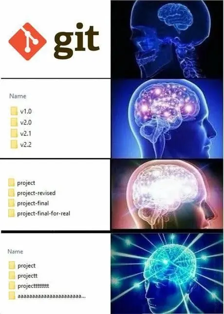
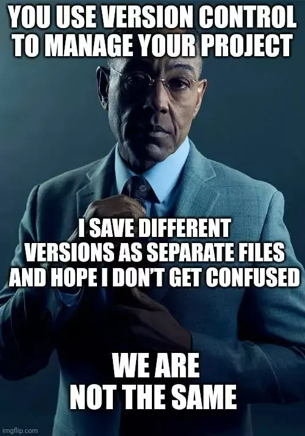
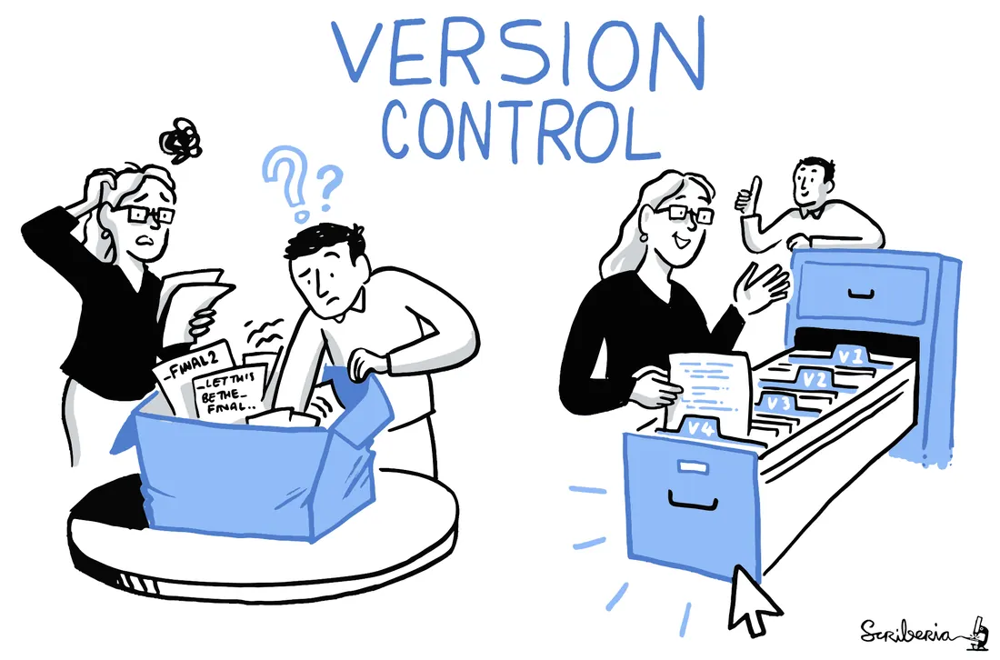
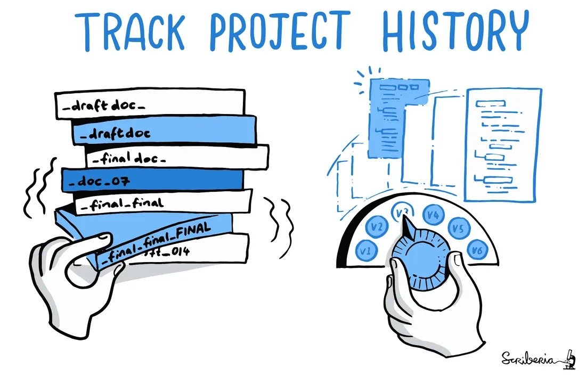
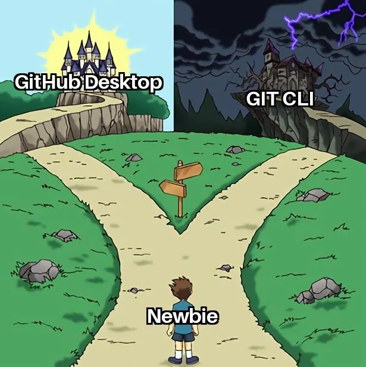
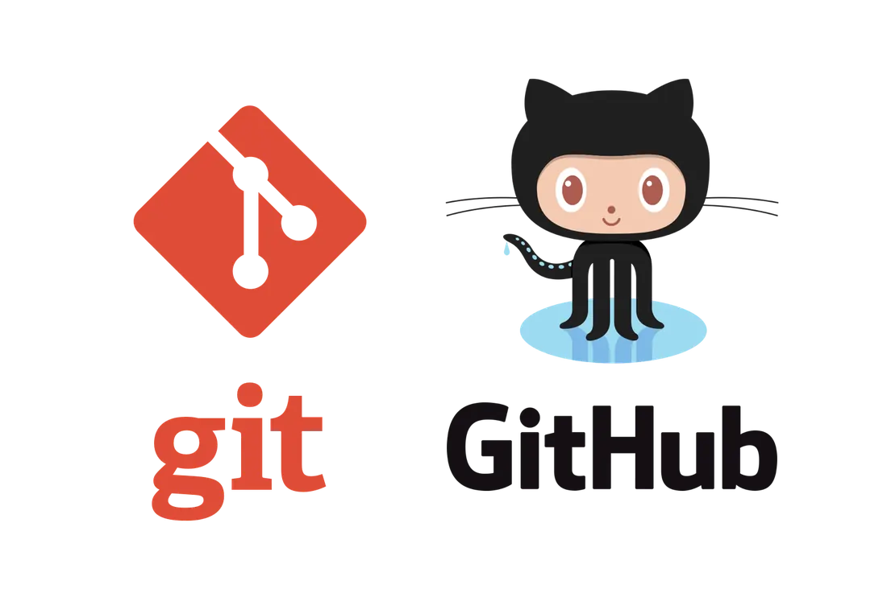
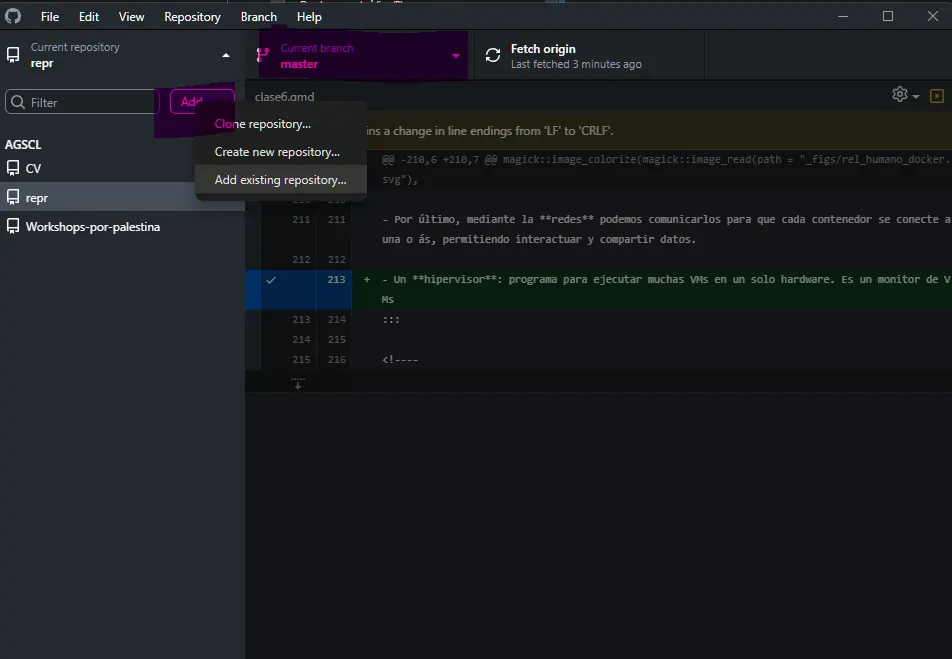
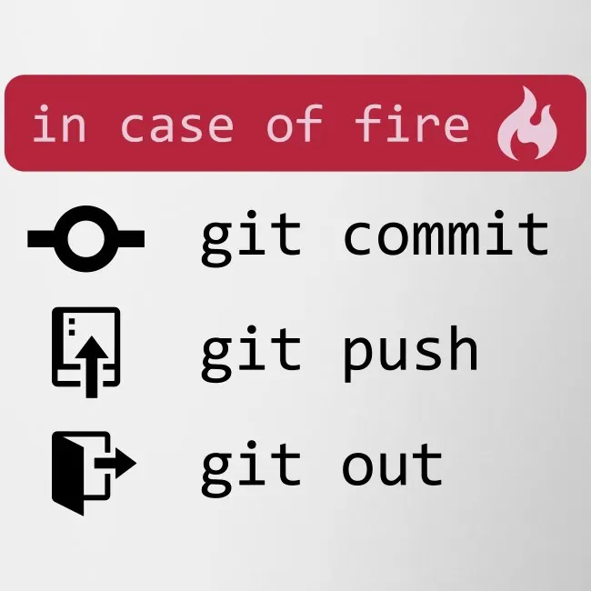
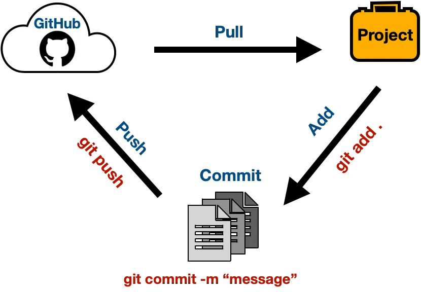
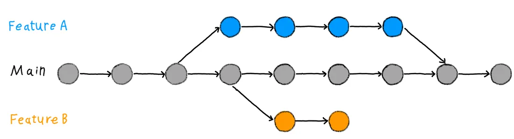

# Parte 1 · La idea {.seccion background-color="#8f4a4a"}

5 minutos. Después, cada idea llega junto con el paso en que se usa.

## ¿Le suena esta carpeta?

:::: {.columns}
::: {.column width="38%"}
```text
informe.docx
informe_v2.docx
informe_final.docx
informe_final_corregido.docx
informe_final_AHORA_SI.docx
```

- ¿Cuál es la versión buena?
- ¿Qué cambió entre una y otra?
- ¿Quién la cambió y por qué?

**¿Cuál es su sufijo favorito?**
:::
::: {.column width="31%"}
{height="640" fig-alt="Meme del cerebro que se expande: de Git, a carpetas v1.0 y v2.0, a carpetas llamadas project-final-for-real, a carpetas con nombres al azar."}
:::
::: {.column width="31%"}
{height="640" fig-alt="Meme: tú usas control de versiones para tu proyecto; yo guardo versiones como archivos separados y espero no confundirme; no somos iguales."}
:::
::::

::: {.notes}
Pedir dos o tres sufijos en voz alta: _final, _v2, _corregido, _ahorasi, la fecha. La regla: nunca use la palabra "final" en un nombre de archivo.
El meme de la derecha dice: "Tú usas control de versiones. Yo guardo versiones en archivos separados y espero no confundirme. No somos iguales."
:::

## Ya usa control de versiones

:::: {.columns}
::: {.column width="48%"}
En **Google Docs**: *Archivo → Historial de versiones*.

- Ve cada versión, con fecha y autor.
- Puede volver a una versión anterior.
- El archivo siempre se llama igual.

Eso es **control de versiones**: guardar la historia de un trabajo, no solo su último estado.

::: {.ojo}
Google Docs lo hace con **un** documento. Un análisis es una **carpeta**: datos, código y resultados.
:::
:::
::: {.column width="52%"}
{width="100%" fig-alt="A la izquierda, dos personas confundidas buscan en una caja con papeles llamados FINAL2. A la derecha, las mismas personas sacan la versión 4 de un archivador ordenado."}

[Ilustración: The Turing Way / Scriberia, CC-BY 4.0. Vía Plaza-Vega (2024).]{.fuente}
:::
::::

## Git hace eso con la carpeta completa

:::: {.columns}
::: {.column width="50%"}
{width="100%" fig-alt="A la izquierda, una pila inestable de documentos llamados draft, final y final_final. A la derecha, una perilla que permite elegir entre las versiones 1 a 6 de un mismo documento."}

[Ilustración: The Turing Way / Scriberia, CC-BY 4.0.]{.fuente}
:::
::: {.column width="50%"}
**Git** es un programa que guarda versiones de una carpeta.

- **Usted decide** cuándo se guarda una versión.
- Cada versión lleva un **mensaje**, un autor y una fecha.
- Puede **comparar** dos versiones y **volver** a cualquiera.

::: {.ojo}
Git muestra qué línea cambió en archivos de **texto**: `.R`, `.qmd`, `.csv`.
En Word o Excel guarda la versión, pero no muestra qué cambió por dentro.
:::
:::
::::

## Lo que logrará hoy

:::: {.columns}
::: {.column width="58%"}
1. Git y GitHub Desktop **instalados**.
2. Un **repositorio** propio en GitHub.
3. Un cambio **subido** desde su computador (push).
4. Un cambio **bajado** desde GitHub (pull).
5. Una **página web** pública con una tabla de la ENSSEX.
6. Un cambio de su compañero o compañera **integrado** en su repositorio.

::: {.ok}
Abra estas diapositivas en su computador y avance a su ritmo:
**agscl.github.io/repr2026/clase-git**
:::
:::
::: {.column width="42%"}
<video controls src="../_figures/git/github-first-time.mp4" style="max-height: 560px; max-width: 100%;"></video>

[Su primera vez con GitHub.]{.chico}
:::
::::

# Parte 2 · Instalar y subir {.seccion background-color="#8f4a4a"}

Cada persona en su computador. Pasos 1 a 10.

## Cómo leer cada paso

:::: {.columns}
::: {.column width="50%"}
Cada paso trae **una** idea nueva y una tarea corta.

A la izquierda, lo que tiene que hacer, en orden.

No siga hasta comprobar que funcionó. Si a la persona de al lado no le resultó, ayúdele antes de avanzar.

Los nombres de menús y botones están en inglés porque así aparecen en GitHub y en GitHub Desktop.
:::
::: {.column width="50%"}
::: {.ok}
**¿Cómo sé que funcionó?** Lo que debe ver antes de seguir. Si no lo ve, levante la mano.
:::

::: {.espejo}
**Lo mismo, escrito.** El comando de Git que hace ese botón. No necesita escribirlo.
:::

::: {.ojo}
**Ojo.** Un error frecuente y cómo evitarlo.
:::

::: {.ojo}
**Nombres sin tildes, sin ñ y sin espacios.** Vale para todo lo que lleva nombre: usuario, repositorio, rama, carpeta y archivo. Escriba `analisis-ninez`, no `análisis niñez`.
Dentro de los archivos y en los mensajes de commit puede escribir normalmente.
:::
:::
::::

## Paso 1 · Cree su cuenta en GitHub

:::: {.columns}
::: {.column width="56%"}
**GitHub** es un sitio web. Guarda una copia de su carpeta en internet y permite compartirla.

1. Entre a **[github.com/signup](https://github.com/signup)**.
2. Escriba un correo que revise seguido y una contraseña.
3. Elija un nombre de usuario (*username*).
4. GitHub le envía un código al correo. Cópielo en la página.

¿Ya tiene cuenta? Entre con ella y pase al paso 2.
:::
::: {.column width="44%"}
::: {.ojo}
**Ojo.** El nombre de usuario es público y será parte de la dirección de su página: `usuario.github.io`. Use minúsculas, sin espacios ni tildes. Por ejemplo, `mariagonzalez-soc`.
:::

::: {.ok}
**¿Cómo sé que funcionó?** Arriba a la derecha de github.com aparece un círculo con su avatar.
:::
:::
::::

## Paso 2 · Instale Git

:::: {.columns}
::: {.column width="56%"}
**Git** es el programa que guarda las versiones. Se instala una sola vez.

1. Entre a **[git-scm.com/downloads/win](https://git-scm.com/downloads/win)**.
2. Descargue **Git for Windows/x64 Setup** y ábralo.
3. El instalador muestra muchas pantallas. Presione **Next** en todas y al final **Install**. Las opciones que vienen marcadas sirven.
4. En el menú Inicio, busque **Git Bash** y ábralo. Es una ventana negra: la terminal.
5. Escriba esto y presione Enter:

```bash
git --version
```
:::
::: {.column width="44%"}
::: {.ok}
**¿Cómo sé que funcionó?** La terminal responde con una versión, por ejemplo `git version 2.52.0.windows.1`. El número puede ser otro.
:::

::: {.ojo}
**¿Tiene Mac?** Abra la aplicación *Terminal* y escriba `git --version`. Si Git no está, el sistema le ofrece instalarlo. Acepte.
:::
:::
::::

## Paso 3 · Preséntese a Git

:::: {.columns}
::: {.column width="62%"}
En la misma ventana de **Git Bash**, escriba estas dos líneas con **su** nombre y **el correo de su cuenta de GitHub**. Presione Enter después de cada una.

```bash
git config --global user.name "María González"
git config --global user.email "maria@udp.cl"
```

Revise lo que quedó guardado:

```bash
git config --global --list
```

Es la única vez de hoy en que escribe comandos. Ya puede cerrar la ventana.
:::
::: {.column width="38%"}
::: {.ok}
**¿Cómo sé que funcionó?** El último comando muestra dos líneas con `user.name=` y `user.email=` y sus datos.
:::

::: {.ojo}
**Ojo.** Las comillas van. Después de las dos primeras líneas la terminal no responde nada: eso es lo normal.
:::

Cada commit que haga quedará firmado con ese nombre. Así su pareja sabrá quién cambió qué.
:::
::::

## Botones o comandos: el mismo lugar

:::: {.columns}
::: {.column width="45%"}
{height="620" fig-alt="Meme de los dos caminos: un principiante elige entre un castillo soleado llamado GitHub Desktop y un castillo con tormenta llamado Git CLI."}
:::
::: {.column width="55%"}
En R se pueden importar datos con el botón *Import Dataset* o escribiendo `read.csv()`. El resultado es el mismo.

Con Git pasa igual:

- **GitHub Desktop**: un clic, y la aplicación le da la orden a Git.
- **Terminal**: la orden se escribe.

::: {.espejo}
En los pasos 2 y 3 escribió comandos. Desde ahora usará botones. En cada paso verá una caja gris como esta, con el comando que ejecuta el botón.
:::
:::
::::

## Paso 4 · Instale GitHub Desktop

:::: {.columns}
::: {.column width="56%"}
1. Entre a **[desktop.github.com](https://desktop.github.com)** y presione **Download for Windows**.
2. Abra el archivo descargado. Se instala solo.
3. Presione **Sign in to GitHub.com**. Se abre el navegador.
4. En el navegador, presione **Authorize desktop**. Si el navegador pregunta, permita abrir GitHub Desktop.
5. De vuelta en la aplicación, en *Configure Git*, presione **Finish**.
:::
::: {.column width="44%"}
::: {.ok}
**¿Cómo sé que funcionó?** Ve la pantalla *Let's get started!* En **File → Options → Accounts** aparece su usuario.
:::

::: {.espejo}
Desktop usa el mismo Git que instaló en el paso 2. En **File → Options → Git** están el nombre y el correo del paso 3.
:::
:::
::::

## Ya tiene las tres cosas: no son lo mismo

:::: {.columns}
::: {.column width="84%"}
|  | Qué es | Dónde está | Se parece a |
|---|---|---|---|
| **Git** | El programa que guarda las versiones | En su computador | El historial de Google Docs |
| **GitHub** | Un sitio web que guarda una copia y la comparte | En internet | Google Drive |
| **GitHub Desktop** | Una aplicación con botones para usar Git | En su computador | El botón *Import Dataset* de RStudio |
| **Git en la terminal** | El mismo Git, usado con comandos escritos | En su computador | Escribir `read.csv()` |
:::
::: {.column width="16%"}
{width="100%" fig-alt="Logotipos de Git y de GitHub."}
:::
::::

::: {.ok}
Git funciona sin GitHub. GitHub no funciona sin Git. Ya instaló los dos programas y creó una cuenta en el sitio.
:::

::: {.notes}
Insistir: Git es de 2005 y es software libre; GitHub es una empresa (de Microsoft) que ofrece dónde guardar repositorios de Git. Existen otros sitios: GitLab, Codeberg.
La terminal también se llama línea de comandos o CLI (command line interface).
:::

## Paso 5 · Cree su repositorio

:::: {.columns}
::: {.column width="56%"}
Un **repositorio** es la carpeta de un proyecto más su historial de versiones.

1. En GitHub Desktop: **File → New repository…**
2. **Name**: `enssex-` más su nombre, sin espacios ni tildes. Por ejemplo, `enssex-maria`.
3. **Local path**: deje la carpeta que propone (`Documentos\GitHub`).
4. Marque **Initialize this repository with a README**.
5. Presione **Create repository**.

Por fuera es una carpeta normal. Véala con **Repository → Show in Explorer**.
:::
::: {.column width="44%"}
{width="92%" fig-alt="GitHub Desktop: el botón Add despliega las opciones Clone repository, Create new repository y Add existing repository."}

::: {.ok}
**¿Cómo sé que funcionó?** Arriba a la izquierda dice *Current repository: enssex-maria*.
:::

::: {.espejo}
**Lo mismo, escrito:** `git init`
:::
:::
::::

## Paso 6 · Ponga un análisis en la carpeta

:::: {.columns}
::: {.column width="58%"}
1. Descargue **[kit-enssex.zip](https://github.com/AGSCL/repr2026/raw/refs/heads/main/clase-git/kit-enssex.zip)**.
2. Clic derecho sobre el ZIP → **Extraer todo**.
3. En Desktop: **Repository → Show in Explorer**.
4. Copie a esa carpeta los dos archivos: `index.qmd` y `enssex_base1.csv`.
5. En RStudio: **File → Open File…** y abra el `index.qmd` de esa carpeta.
6. En la línea `author:` escriba su nombre. Guarde.
7. Presione **Render**.
:::
::: {.column width="42%"}
::: {.ok}
**¿Cómo sé que funcionó?** RStudio muestra una página con una tabla de 2 × 2. En la carpeta hay un archivo nuevo: `index.html`.
:::

::: {.ojo}
**Ojo.** Copie los archivos sueltos, no la carpeta `kit-enssex`. Deben quedar junto a `README.md`.

Si RStudio pide instalar `rmarkdown` o `knitr`, acepte.
:::
:::
::::

## Commit: una versión guardada, con un mensaje

Guardar el archivo (Ctrl+S) no basta. Un **commit** guarda una versión de toda la carpeta y lleva un mensaje.

Acaba de cambiar el filtro de edad de un análisis. ¿Qué mensaje deja?

1. `Cambios`
2. `Cambié la línea 17 de index.qmd donde decía 18 y ahora dice 30`
3. `Cambia filtro de edad a 30-44 años`

. . .

::: {.ok}
**El 3.** Tiene menos de 50 caracteres, empieza con un verbo y nombra una acción concreta.
El 1 no dice nada. El 2 repite lo que Git ya muestra por su cuenta.
:::

Ese mensaje lo leerá otra persona. Puede ser usted, seis meses después.

::: {.notes}
Tomado de la lección "Version Control with Git in RStudio" (Epiverse-TRACE / The Carpentries, CC-BY 4.0).
:::

## Paso 7 · Su primer commit

:::: {.columns}
::: {.column width="56%"}
Vuelva a GitHub Desktop. A la izquierda, en **Changes**, Git ya vio los archivos nuevos.

1. Revise que los tres archivos tengan la casilla marcada.
2. Abajo, en **Summary**, escriba el mensaje:
   `Agrega análisis ENSSEX y su página`
3. Presione **Commit to main**.

La lista *Changes* queda vacía: todo está guardado en una versión.
:::
::: {.column width="44%"}
::: {.ok}
**¿Cómo sé que funcionó?** En la pestaña **History** aparece su mensaje, con su nombre y la hora.
:::

::: {.espejo}
**Lo mismo, escrito:**

```bash
git add .
git commit -m "Agrega análisis ENSSEX y su página"
```
:::

El commit está en su computador. En GitHub todavía no hay nada.
:::
::::

## Lo que no subió solo existe en su computador

:::: {.columns}
::: {.column width="40%"}
{height="600" fig-alt="Cartel: en caso de incendio, git commit, git push, y salga del edificio."}
:::
::: {.column width="60%"}
**Push** es subir sus commits a GitHub. El orden de siempre: **commit**, luego **push**.

GitHub es una copia fuera de su computador. Si el computador falla, el proyecto sigue ahí.

::: {.ojo}
**Qué no se sube a un repositorio público**

- Datos con nombres, RUT u otra información personal.
- Contraseñas y claves.
- Archivos muy grandes (GitHub rechaza los de más de 100 MB).

Un archivo llamado `.gitignore` lista lo que Git debe dejar fuera. El historial conserva lo que ya se subió, aunque después lo borre.
:::
:::
::::

## Paso 8 · Súbalo a GitHub (push)

:::: {.columns}
::: {.column width="56%"}
1. Arriba, presione **Publish repository**.
2. **Desmarque** la casilla *Keep this code private*.
3. Presione **Publish repository**.
4. Cuando termine: **Repository → View on GitHub**.

La primera vez el botón dice *Publish repository*. Desde ahora dirá **Push origin** cada vez que tenga commits sin subir.
:::
::: {.column width="44%"}
::: {.ok}
**¿Cómo sé que funcionó?** En el navegador ve sus cuatro archivos en `github.com/usuario/enssex-maria`.
:::

::: {.ojo}
**Ojo.** Con una cuenta gratuita, la página web del paso 9 solo funciona si el repositorio es público. La ENSSEX es una base pública y anónima.
:::

::: {.espejo}
**Lo mismo, escrito:** `git push`
:::
:::
::::

## Paso 9 · Publique la página (GitHub Pages)

:::: {.columns}
::: {.column width="56%"}
En el navegador, dentro de su repositorio:

1. Entre a **Settings** (arriba, a la derecha).
2. En el menú de la izquierda, elija **Pages**.
3. En *Branch*, cambie **None** por **main**. Deje `/ (root)`.
4. Presione **Save**.
5. Espere uno o dos minutos y recargue la página.

GitHub Pages muestra como sitio web el archivo `index.html` de su repositorio.
:::
::: {.column width="44%"}
::: {.ok}
**¿Cómo sé que funcionó?** Arriba aparece *Your site is live at* con una dirección como
`https://usuario.github.io/enssex-maria/`
Ábrala: es su tabla, visible para cualquiera.
:::

::: {.ojo}
**¿Error 404?** Espere un minuto más. Revise que el archivo se llame exactamente `index.html` y que no esté dentro de otra carpeta.
:::
:::
::::

## Paso 10 · De GitHub a su computador (pull)

:::: {.columns}
::: {.column width="56%"}
**Pull** es bajar a su computador los commits que hay en GitHub. Ahora el cambio nace allá y hay que bajarlo.

1. En el navegador, abra `README.md` en su repositorio.
2. Presione el lápiz (*Edit this file*).
3. Agregue una línea: `Tabla de estado civil según sexo, ENSSEX.`
4. Presione **Commit changes…** y confirme.
5. En GitHub Desktop, presione **Fetch origin**. El botón cambia a **Pull origin**. Presiónelo.
:::
::: {.column width="44%"}
::: {.ok}
**¿Cómo sé que funcionó?** Abra `README.md` desde la carpeta de su computador: la línea nueva está ahí. En **History** hay un commit más.
:::

::: {.espejo}
**Lo mismo, escrito:** `git pull`
:::

*Fetch* pregunta si hay novedades. *Pull* las trae. Antes de empezar a trabajar, siempre haga pull.
:::
::::

## Cuatro palabras que ya usó

:::: {.columns}
::: {.column width="54%"}
- **Repositorio**: la carpeta del proyecto más su historial.
- **Commit**: una versión guardada, con un mensaje que dice qué cambió.
- **Push**: subir sus commits a GitHub.
- **Pull**: bajar a su computador los commits que hay en GitHub.

::: {.ojo}
Guardar un archivo (Ctrl+S) no es hacer un commit, y hacer un commit no es subirlo. Son tres pasos distintos.
:::
:::
::: {.column width="46%"}
{width="100%" fig-alt="Ciclo: Pull trae el proyecto desde GitHub; Add elige los archivos; Commit guarda la versión con un mensaje; Push la sube a GitHub."}

[*Add* es elegir qué archivos entran en el commit. En Desktop son las casillas marcadas.]{.chico}
:::
::::

# Parte 3 · Colaborar {.seccion background-color="#8f4a4a"}

En parejas. Pasos 11 a 17.

## Así viaja un cambio entre dos personas

Decidan quién es [A]{.rol .a} y quién es [B]{.rol .b}. Trabajarán en el repositorio de [A]{.rol .a}.

:::: {.columns}
::: {.column width="56%"}
1. [A]{.rol .a} invita a [B]{.rol .b} a su repositorio.
2. [B]{.rol .b} lo **clona**: baja una copia completa.
3. [B]{.rol .b} crea una **rama**: una línea de trabajo separada de `main`.
4. [B]{.rol .b} cambia el filtro, hace commit y sube la rama.
5. [B]{.rol .b} abre un **pull request**: le pide a [A]{.rol .a} que integre su cambio.
6. [A]{.rol .a} revisa el cambio y lo **fusiona** (*merge*) con `main`.
:::
::: {.column width="44%"}
{width="100%" fig-alt="Una línea gris llamada Main de la que salen dos ramas, Feature A y Feature B. La rama A vuelve a unirse a Main."}

::: {.ok}
La rama protege a `main`. Lo que está en `main` es lo que se ve en la página pública, y solo cambia cuando [A]{.rol .a} acepta.
:::
:::
::::

## Paso 11 · [A]{.rol .a} invita, [B]{.rol .b} acepta

:::: {.columns}
::: {.column width="50%"}
[A]{.rol .a} **en el navegador, en su repositorio:**

1. **Settings → Collaborators**.
2. Presione **Add people**.
3. Escriba el nombre de usuario de [B]{.rol .b} y elíjalo.
4. Presione **Add … to this repository**.
:::
::: {.column width="50%"}
[B]{.rol .b} **en su correo o en el navegador:**

1. Abra el correo de GitHub y presione **View invitation**.
2. Presione **Accept invitation**.

¿No llegó el correo? Entre a
`github.com/USUARIO-A/REPOSITORIO/invitations`
:::
::::

::: {.ok}
**¿Cómo sé que funcionó?** [A]{.rol .a} ve a [B]{.rol .b} en la lista de *Collaborators*, ya sin el aviso *Pending invite*.
:::

## Paso 12 · [B]{.rol .b} clona el repositorio de [A]{.rol .a}

:::: {.columns}
::: {.column width="56%"}
**Clonar** es bajar por primera vez una copia completa de un repositorio que está en GitHub.

[B]{.rol .b} **en GitHub Desktop:**

1. **File → Clone repository…** y elija la pestaña **URL**.
2. Escriba `USUARIO-A/REPOSITORIO`. Por ejemplo, `mariagonzalez-soc/enssex-maria`.
3. Presione **Clone**.
:::
::: {.column width="44%"}
::: {.ok}
**¿Cómo sé que funcionó?** Arriba dice *Current repository: enssex-maria*. Con **Repository → Show in Explorer**, [B]{.rol .b} ve en su computador la carpeta de [A]{.rol .a}, con `index.qmd` adentro.
:::

::: {.espejo}
**Lo mismo, escrito:**

```bash
git clone https://github.com/USUARIO-A/REPOSITORIO.git
```
:::
:::
::::

## Paso 13 · [B]{.rol .b} crea una rama

:::: {.columns}
::: {.column width="56%"}
Una **rama** (*branch*) es una línea de trabajo separada de `main`. Lo que [B]{.rol .b} haga en ella no toca la versión principal.

[B]{.rol .b} **en GitHub Desktop:**

1. Arriba, presione **Current branch → New branch**.
2. Nombre: `filtro-edad`. Sin espacios, tildes ni ñ.
3. Presione **Create branch**.

[A]{.rol .a} acompaña mirando la pantalla de [B]{.rol .b}.
:::
::: {.column width="44%"}
::: {.ok}
**¿Cómo sé que funcionó?** Arriba dice *Current branch: filtro-edad*.
:::

::: {.espejo}
**Lo mismo, escrito:** `git switch -c filtro-edad`
:::
:::
::::

## Paso 14 · [B]{.rol .b} cambia el filtro y sube la rama

:::: {.columns}
::: {.column width="58%"}
No hay idea nueva: es el commit y el push que ya hizo, ahora en la rama.

1. En RStudio, abra el `index.qmd` del repositorio de [A]{.rol .a} (**Repository → Show in Explorer** le muestra dónde está).
2. Cambie **solo** estos dos números y guarde:

```r
edad_min <- 30
edad_max <- 44
```

3. Presione **Render**. La tabla cambia.
4. En Desktop: mensaje `Cambia filtro de edad a 30-44 años` y **Commit to filtro-edad**.
5. Presione **Publish branch**.
:::
::: {.column width="42%"}
::: {.ok}
**¿Cómo sé que funcionó?** Antes del commit, haga clic en `index.qmd` dentro de *Changes*: las líneas antiguas están en rojo y las nuevas en verde.

Al final, [A]{.rol .a} recarga su repositorio en el navegador: junto a `main` ahora dice **2 Branches**.
:::

::: {.ojo}
**Ojo.** Hay dos archivos cambiados: `index.qmd` (lo que escribió) e `index.html` (lo que generó Render). Suba los dos.
:::
:::
::::

## Paso 15 · [B]{.rol .b} abre un pull request

:::: {.columns}
::: {.column width="56%"}
Un **pull request** es una solicitud: [B]{.rol .b} le pide a [A]{.rol .a} que revise su cambio y lo integre a `main`.

1. En Desktop, presione **Create Pull Request**. Se abre el navegador.
2. Revise que diga `base: main` y `compare: filtro-edad`.
3. Presione **Create pull request**.
:::
::: {.column width="44%"}
::: {.ok}
**¿Cómo sé que funcionó?** El navegador muestra el pull request con la etiqueta verde **Open**. [A]{.rol .a} lo ve en la pestaña **Pull requests** de su repositorio.
:::

::: {.ojo}
**Ojo.** El nombre confunde: no es el *pull* del paso 10. Es una solicitud para integrar un cambio.
:::

::: {.espejo}
Aquí no hay comando de Git. El pull request existe en GitHub, el sitio web.
:::
:::
::::

## Paso 16 · [A]{.rol .a} revisa, fusiona y baja el cambio

:::: {.columns}
::: {.column width="56%"}
**Fusionar** (*merge*) es integrar la rama en `main`. Lo decide [A]{.rol .a}.

[A]{.rol .a} **en el navegador, en su repositorio:**

1. Entre a la pestaña **Pull requests** y abra el de [B]{.rol .b}.
2. En **Files changed**, mire qué cambió en `index.qmd`.
3. Vuelva a **Conversation** y presione **Merge pull request**. Luego **Confirm merge**.

[A]{.rol .a} **en GitHub Desktop:**

4. **Fetch origin** y después **Pull origin**.
:::
::: {.column width="44%"}
::: {.ok}
**¿Cómo sé que funcionó?**

- El pull request queda con la etiqueta morada **Merged**.
- En **History**, [A]{.rol .a} ve un commit con el nombre de [B]{.rol .b}.
- Uno o dos minutos después, la página pública de [A]{.rol .a} muestra la tabla de 30 a 44 años.
:::

::: {.espejo}
**Lo mismo, escrito:** `git pull`
:::
:::
::::

## Paso 17 · Cambien de rol

:::: {.columns}
::: {.column width="56%"}
Repitan los pasos 11 a 16 en el repositorio de [B]{.rol .b}.

Ahora [B]{.rol .b} invita y fusiona. [A]{.rol .a} clona, crea la rama, cambia el filtro a otro tramo de edad y abre el pull request.

Antes de empezar, [B]{.rol .b} vuelve a su propio repositorio en Desktop: **Current repository → enssex-…**
:::
::: {.column width="44%"}
::: {.ok}
**Terminaron cuando** cada persona tiene:

- una página pública con una tabla que cambió su pareja;
- un commit de su pareja en **History**;
- un pull request en estado **Merged**.
:::

Envíen las dos direcciones de sus páginas al profesor.
:::
::::

## Si algo falla

| Lo que ve | Qué hacer |
|---|---|
| La página da error **404** | Espere dos minutos. Revise que `index.html` esté en la raíz y que el repositorio sea público. |
| GitHub no lo deja crear la cuenta | Hay muchas cuentas nuevas desde la misma red. Use los datos del teléfono para ese paso. |
| Desktop dice **Authentication failed** | **File → Options → Accounts → Sign in**. |
| [B]{.rol .b} no puede publicar la rama | [B]{.rol .b} todavía no acepta la invitación (paso 11). |
| El botón dice **Pull origin** y no lo deja subir | Primero **Pull origin**, después **Push origin**. |
| Algo falla y un nombre tiene tilde, ñ o espacio | Cambie ese nombre por uno sin tildes, ñ ni espacios y repita el paso. |
| RStudio no muestra el botón **Render** | Su RStudio es antiguo. Avise al profesor. |
| Desktop habla de un **conflicto** (*conflict*) | No presione nada. Levante la mano. |

# Cierre {.seccion background-color="#8f4a4a"}

## Lo que hizo hoy, con sus nombres

:::: {.columns}
::: {.column width="50%"}
| El botón | El comando |
|---|---|
| New repository | `git init` |
| Casillas + Commit | `git add` y `git commit` |
| Publish / Push origin | `git push` |
| Fetch / Pull origin | `git pull` |
| Clone repository | `git clone` |
| New branch | `git switch -c` |
| History | `git log` |
:::
::: {.column width="50%"}
**Lo que viene**

- Un `README.md` que explique qué hay en el repositorio y cómo se usa.
- Una **licencia**: qué pueden hacer otras personas con su trabajo.
- Un `.gitignore` para dejar fuera lo que no se sube.
- Repositorios que guardan datos extraídos de la web y se actualizan solos.

Para seguir practicando sin riesgo: [simulador de Git y GitHub](https://github.com/AGSCL/repr2026/raw/refs/heads/main/_outputs/taller-git-autocontenido.zip).
:::
::::

## Fuentes

::: {.chico}
- Plaza-Vega, F. (2024). *Mini curso: Quarto y GitHub Pages*. III Jornadas de Ingeniería Estadística, Universidad de Santiago de Chile. <https://github.com/FranPlaza/Quarto-Github>
- Epiverse-TRACE y The Carpentries. *Version Control with Git in RStudio*. CC-BY 4.0. <https://epiverse-trace.github.io/git-rstudio-basics/>
- The Turing Way Community y Scriberia (2019). *Illustrations from the Turing Way*. CC-BY 4.0. <https://doi.org/10.5281/zenodo.3332807>
- Ministerio de Salud de Chile. *Encuesta Nacional de Salud, Sexualidad y Género (ENSSEX) 2022–2023*.
- Tipografía Oswald, SIL Open Font License 1.1.

Código de estas diapositivas: <https://github.com/AGSCL/repr2026>
:::

## Antes de irse: ¿cómo estuvo la clase?

:::: {.columns}
::: {.column width="45%"}
{height="600" fig-alt="Código QR que lleva a la encuesta de retroalimentación de la clase."}
:::
::: {.column width="55%"}
Apunte la cámara del teléfono al código y responda la encuesta de la clase.

Cuente qué le sirvió, qué quedó confuso y qué cambiaría. Con eso se ajusta la próxima sesión.

{height="300" fig-alt="Piolín da las gracias."}
:::
::::
