# Parte 1 · La idea {.seccion background-color="#8f4a4a"}

5 minutos. Después, una pieza por etapa.

## Ya usó una app Shiny

:::: {.columns}
::: {.column width="55%"}
La encuesta que respondió antes de la primera clase era una app hecha con **Shiny**.

Tenía dos mitades:

- **Lo que se ve**: las preguntas y el botón para enviar.
- **Lo que se calcula**: código R que revisaba y guardaba las respuestas.

Hoy construirá las dos mitades, primero con ejemplos chicos y después con datos reales.

[Código de esa encuesta: [encuesta/app.R](https://github.com/AGSCL/repr2026/blob/main/encuesta/app.R)]{.chico}
:::
::: {.column width="45%"}
::: {.ok}
**Shiny** es un paquete de R para construir aplicaciones web.

- Se escribe en R. No hace falta saber HTML ni JavaScript.
- Convierte un análisis en algo que otra persona puede explorar sin abrir R.
:::
:::
::::

::: {.notes}
De la clase 5 de 2024: para mí Shiny no es tanto una herramienta de reproducibilidad como de comunicación de resultados, al servicio de la ciencia abierta.
:::

## De una tabla fija a una app

:::: {.columns}
::: {.column width="42%"}
En la clase de Git publicó una tabla. Respondía **una** pregunta, para **un** tramo de edad.

Para ver otro tramo había que cambiar el código, renderizar y subir de nuevo.

En una app, quien visita la página **mueve un control** y el gráfico y la tabla cambian solos. Puede hacer sus propias preguntas.
:::
::: {.column width="58%"}
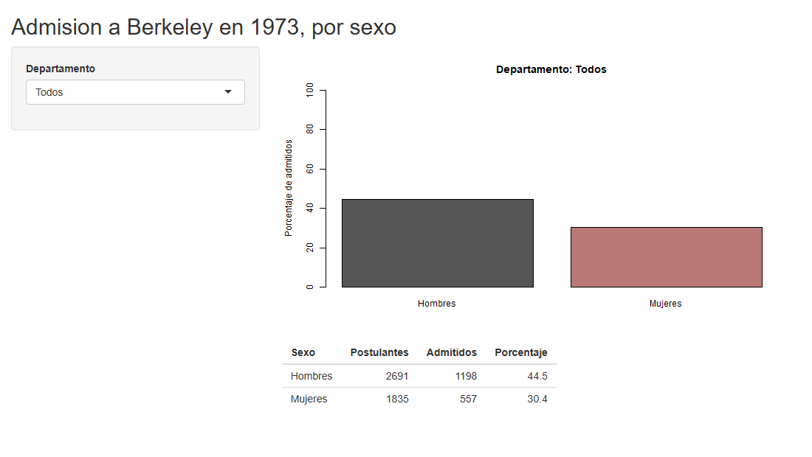{width="100%" fig-alt="La app terminada: a la izquierda un menú para elegir departamento; a la derecha un gráfico de barras con el porcentaje de hombres y de mujeres admitidos y, debajo, una tabla con postulantes, admitidos y porcentaje."}
:::
::::

## Toda app tiene dos mitades

::: {.flujo}
::: {.caja}
**`ui`: lo que se ve**

Un control (*input*) que la persona mueve: un deslizador, un menú.
:::

[→]{.flecha}

::: {.caja .server}
**`server`: lo que se calcula**

Código R que lee el control y prepara un resultado.
:::

[→]{.flecha}

::: {.caja}
**`ui`: lo que se ve**

Un resultado (*output*) que aparece en la página: un texto, un gráfico, una tabla.
:::
:::

Al final, una línea las une: `shinyApp(ui, server)`.

::: {.ok}
Cinco etapas, una pieza cada una: la página, un control, un resultado, un gráfico y el orden en la pantalla.
:::

::: {.notes}
ui es el front-end: lo que definimos y personalizamos. server es el back-end: la lógica que genera los resultados. Lee input$..., y entrega output$... por medio de las funciones render.
:::

## Ruta de hoy

1. **Las partes de una app.** Cinco etapas en el navegador, sin instalar nada.
2. **Su app con datos reales.** En RStudio, en un repositorio nuevo.
3. **Publicarla sin servidor.** Primero como un enlace; después en GitHub Pages.
4. **Publicarla con servidor.** En Posit Connect Cloud, desde GitHub.

::: {.ok}
Cada parte deja algo funcionando. Si una posterior falla, lo anterior sigue en pie.
:::

::: {.ojo}
De la clase de Git solo necesita su cuenta de GitHub y GitHub Desktop. Los datos vienen con R: no hay archivos que copiar.
:::

# Parte 2 · Las partes de una app {.seccion background-color="#8f4a4a"}

En el navegador. Etapas 1 a 5.

## Cómo usar el editor vivo

:::: {.columns}
::: {.column width="52%"}
Cada etapa trae un recuadro con dos mitades: 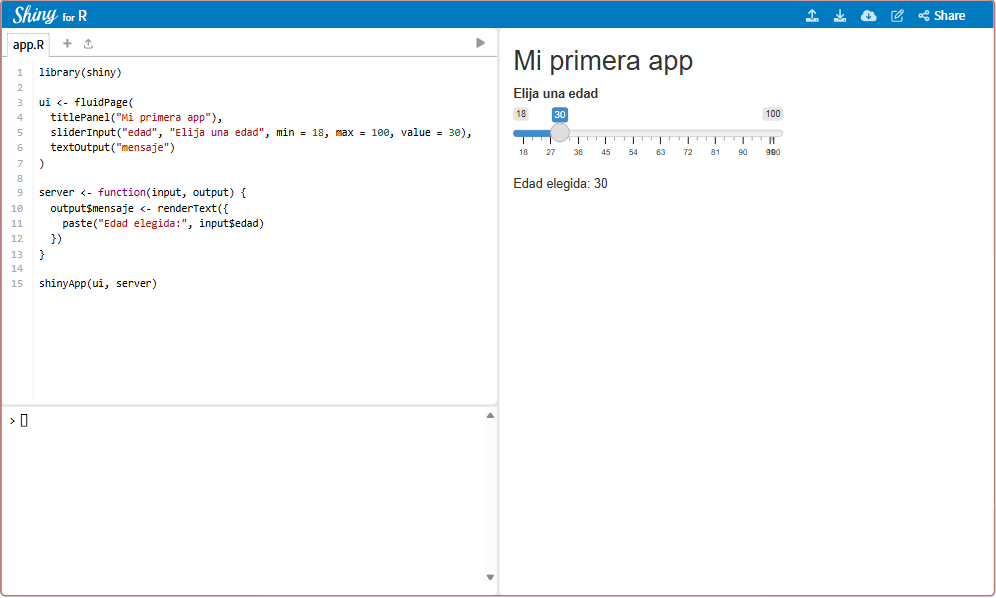{.captura}

- **A la izquierda**, el código. Se puede editar.
- **A la derecha**, la app que ese código produce.
- **El botón ▶**, arriba del código, vuelve a correr la app con sus cambios.

Nada se instala: R corre dentro de su navegador.
:::
::: {.column width="48%"}
::: {.ojo}
**La primera carga tarda.** Puede pasar hasta un minuto con un círculo girando. Las siguientes son más rápidas.
:::

::: {.ok}
**Si se equivoca**, recargue la página (F5): el código vuelve al original.
:::

::: {.espejo}
**Si el recuadro queda en blanco**, use el enlace *Abrir este editor en una pestaña nueva* que está debajo.
:::
:::
::::

## Etapa 1 · La página: `ui` {.etapa}

:::: {.columns}
::: {.column width="27%"}
`ui` es lo que se ve. Aquí la página solo tiene un texto.

`server` está vacío: todavía no hay nada que calcular.

**Hágalo**

1. Espere a que aparezca la app a la derecha.
2. Cambie el texto entre comillas por su nombre.
3. Presione ▶.

::: {.ok}
**¿Funcionó?** La app muestra su nombre.
:::
:::
::: {.column width="73%"}
::: {.vivo}
```r
library(shiny)
# ui: lo que se ve. Aqui, solo un texto
ui <- fluidPage(
  "Hola, soy una app"
)
# server: lo que se calcula. Todavia nada
server <- function(input, output) {
}
# La linea que une las dos mitades
shinyApp(ui, server)
```
:::
:::
::::

## Etapa 2 · Un control: `input` {.etapa}

:::: {.columns}
::: {.column width="27%"}
Un control es una pieza de `ui` que la persona puede mover. Este es un deslizador.

Lleva un **nombre interno** (`"edad"`), una etiqueta y sus valores.

**Hágalo**

1. Mueva el deslizador. No pasa nada más: nadie lo está escuchando.
2. Cambie `value = 30` por `value = 50` y presione ▶.

::: {.ok}
**¿Funcionó?** El deslizador parte en 50.
:::
:::
::: {.column width="73%"}
::: {.vivo}
```r
library(shiny)
ui <- fluidPage(
  titlePanel("Mi primera app"),
  # Un control: nombre interno, etiqueta y valores
  sliderInput("edad", "Elija una edad", min = 18, max = 100, value = 30)
)
# Nadie escucha el control todavia
server <- function(input, output) {
}
shinyApp(ui, server)
```
:::
:::
::::

## Etapa 3 · Un resultado: `output` {.etapa}

:::: {.columns}
::: {.column width="27%"}
Ahora `server` escucha. Lee el control con `input$edad` y escribe un resultado en `output$mensaje`.

En `ui`, `textOutput("mensaje")` reserva el lugar donde aparece.

**Hágalo**

1. Mueva el deslizador: el texto cambia solo.
2. En `ui`, cambie `"mensaje"` por `"aviso"` y presione ▶. El texto desaparece.
3. Arréglelo: en `server` escriba `output$aviso`.

::: {.ok}
**La idea:** el nombre debe ser el mismo en las dos mitades.
:::
:::
::: {.column width="73%"}
::: {.vivo}
```r
library(shiny)
ui <- fluidPage(
  titlePanel("Mi primera app"),
  sliderInput("edad", "Elija una edad", min = 18, max = 100, value = 30),
  # El lugar donde aparece el resultado llamado "mensaje"
  textOutput("mensaje")
)
server <- function(input, output) {
  # Lee el control (input$edad) y escribe el resultado (output$mensaje)
  output$mensaje <- renderText({
    paste("Edad elegida:", input$edad)
  })
}
shinyApp(ui, server)
```
:::
:::
::::

## Etapa 4 · Un gráfico que responde {.etapa}

:::: {.columns}
::: {.column width="27%"}
Cada resultado tiene su pareja: `plotOutput` en `ui` y `renderPlot` en `server`. Para una tabla, `tableOutput` y `renderTable`.

Dentro de `renderPlot` va código de gráfico como el que ya conoce.

**Hágalo**

1. Mueva el deslizador.
2. Cambie `"gray"` por `"tomato"` y presione ▶.

::: {.ok}
**¿Funcionó?** El histograma cambia con el deslizador y ahora es rojo.
:::
:::
::: {.column width="73%"}
::: {.vivo}
```r
library(shiny)
ui <- fluidPage(
  titlePanel("Un grafico que responde"),
  sliderInput("n", "Cantidad de personas", min = 10, max = 500, value = 50),
  # El lugar del grafico
  plotOutput("grafico")
)
server <- function(input, output) {
  # renderPlot vuelve a dibujar cada vez que cambia input$n
  output$grafico <- renderPlot({
    edades <- rnorm(input$n, mean = 40, sd = 12)
    hist(edades, col = "gray", border = "white", main = "Edades simuladas")
  })
}
shinyApp(ui, server)
```
:::
:::
::::

## Etapa 5 · Ordenar la pantalla y conectar un control {.etapa}

:::: {.columns}
::: {.column width="27%"}
`sidebarLayout` separa la página: los controles a un lado (`sidebarPanel`) y los resultados al otro (`mainPanel`).

Hay un control nuevo, **Color**, pero no hace nada.

**Hágalo**

1. Cambie el color en el menú: el gráfico no reacciona.
2. Conéctelo: en `server`, cambie `col = "gray"` por `col = input$color`.
3. Presione ▶ y pruebe el menú.

::: {.ok}
**¿Funcionó?** El histograma toma el color elegido.
:::
:::
::: {.column width="73%"}
::: {.vivo}
```r
library(shiny)
ui <- fluidPage(
  titlePanel("Controles a un lado, resultados al otro"),
  sidebarLayout(
    # A un lado, los controles
    sidebarPanel(
      sliderInput("n", "Cantidad de personas", min = 10, max = 500, value = 50),
      selectInput("color", "Color", choices = c("gray", "tomato", "steelblue"))
    ),
    # Al otro, los resultados
    mainPanel(
      plotOutput("grafico")
    )
  )
)
server <- function(input, output) {
  output$grafico <- renderPlot({
    edades <- rnorm(input$n, mean = 40, sd = 12)
    # El color esta fijo: falta conectarlo con input$color
    hist(edades, col = "gray", border = "white", main = "Edades simuladas")
  })
}
shinyApp(ui, server)
```
:::
:::
::::

## Antes de seguir: ¿`ui` o `server`? {.etapa}

¿En qué mitad va cada línea?

1. `sliderInput("edad", "Rango de edad", min = 18, max = 100, value = 30)`
2. `output$tabla <- renderTable({ ... })`
3. `tableOutput("tabla")`
4. `paste("Edad elegida:", input$edad)`

. . .

::: {.ok}
**1 y 3 van en `ui`**: son cosas que se ven, un control y el lugar de un resultado.
**2 y 4 van en `server`**: son cálculos. Leen `input$…` y escriben `output$…`.
:::

| Pieza | Mitad | Ejemplo |
|---|---|---|
| Control | `ui` | `sliderInput("edad", …)` |
| Lugar del resultado | `ui` | `plotOutput("grafico")` |
| Cálculo del resultado | `server` | `output$grafico <- renderPlot({ … })` |
| Unión | al final | `shinyApp(ui, server)` |

# Parte 3 · Su app con datos reales {.seccion background-color="#8f4a4a"}

En RStudio, en un repositorio nuevo. Pasos 1 a 6.

## Paso 1 · Instale los paquetes

:::: {.columns}
::: {.column width="56%"}
En la consola de RStudio:

```r
install.packages(c("shiny", "rsconnect"))
```

- `shiny` construye la app.
- `rsconnect` la prepara para Connect Cloud (parte 5).
:::
::: {.column width="44%"}
::: {.ok}
**¿Cómo sé que funcionó?** La instalación termina sin la palabra `Error`. Después, `library(shiny)` no responde nada.
:::

::: {.ojo}
**Ojo.** Si arriba a la derecha de RStudio aparece el nombre de un proyecto, ciérrelo antes: **File → Close Project**.
:::
:::
::::

## Paso 2 · Cree un repositorio para la app

:::: {.columns}
::: {.column width="56%"}
Es lo mismo de la clase de Git.

1. En GitHub Desktop: **File → New repository…**
2. **Name**: `shiny-` más su nombre. Por ejemplo, `shiny-maria`.
3. Marque **Initialize this repository with a README**.
4. Presione **Create repository**.
5. Abra **Repository → Show in Explorer** y cree ahí una carpeta llamada `app`.
:::
::: {.column width="44%"}
::: {.ok}
**¿Cómo sé que funcionó?** La carpeta del repositorio tiene un `README.md` y una carpeta `app` vacía.
:::

::: {.ojo}
**Ojo.** Sin tildes, sin ñ y sin espacios, en el repositorio y en la carpeta. La carpeta debe llamarse exactamente `app`.
:::
:::
::::

## Paso 3 · Escriba la app

:::: {.columns}
::: {.column width="56%"}
1. En RStudio: **File → New File → R Script**.
2. Pegue el código de la lámina siguiente.
3. **File → Save As…**, entre a la carpeta `app` de su repositorio y guárdelo como `app.R`.

Una app vive en su propia carpeta. Esta no necesita nada más: los datos vienen con R.
:::
::: {.column width="44%"}
::: {.ok}
**¿Cómo sé que funcionó?** En RStudio, arriba del código, aparece el botón **Run App**. 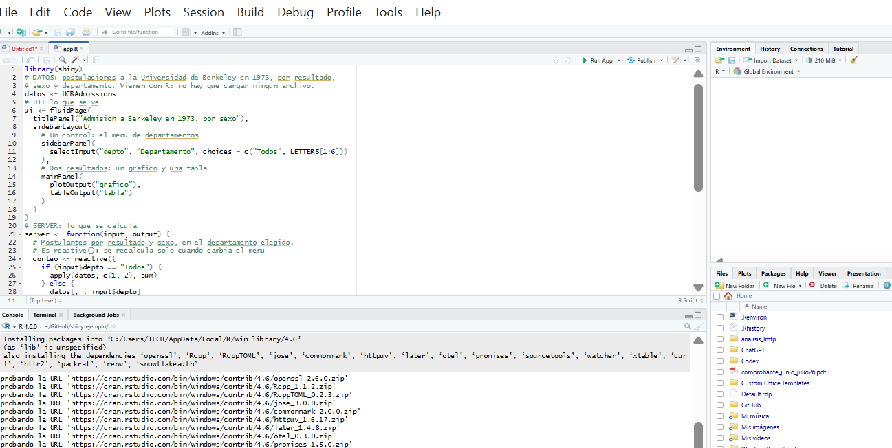{.captura}
:::

::: {.ojo}
**Ojo.** El archivo debe llamarse exactamente `app.R`.
:::
:::
::::

## El código de su app {.etapa .codigo}

:::: {.columns}
::: {.column width="60%"}
```r

```
:::
::: {.column width="40%"}
Copie todo con el botón que aparece arriba a la derecha del código.

**Ya conoce casi todo:**

- un control en `sidebarPanel`;
- un gráfico y una tabla en `mainPanel`;
- `renderPlot` y `renderTable` en `server`.

::: {.ok}
**Lo nuevo: `reactive()`.** El gráfico y la tabla usan el mismo cálculo. Se escribe una vez, se le pone nombre (`porcentaje`) y se usa con paréntesis: `porcentaje()`.
:::

::: {.ojo}
El código no tiene tildes ni ñ, tampoco en los textos: en algunos computadores se ven como signos raros.
:::
:::
::::

## Paso 4 · Córrala y hágale una pregunta a los datos

:::: {.columns}
::: {.column width="56%"}
1. Con `app.R` abierto, presione **Run App**. Se abre una ventana con la app. {.captura}
2. Deje *Todos*. ¿Admitían más a los hombres?
3. Ahora elija los departamentos, uno por uno. ¿Se mantiene?
4. Para detenerla, cierre la ventana o presione el botón rojo **Stop** de la consola.

Mientras la app corre, la consola dice `Listening on http://127.0.0.1:…` y no acepta otros comandos. Es lo normal.
:::
::: {.column width="44%"}
::: {.ok}
**¿Cómo sé que funcionó?** Con *Todos*, la tabla dice **44.5** para hombres y **30.4** para mujeres. Con el departamento *A*, **62.1** y **82.4**.
:::

::: {.espejo}
Una tabla fija habría mostrado solo el total. La app deja ver que la diferencia cambia, y hasta se invierte, dentro de cada departamento.
:::
:::
::::

::: {.notes}
Es la paradoja de Simpson. Las mujeres postulaban más a los departamentos con menos cupos (C a F), donde se rechazaba a casi todo el mundo. Bickel, Hammel y O'Connell, Science, 1975.
:::

## Paso 5 · Hágala suya

:::: {.columns}
::: {.column width="56%"}
Cambie dos cosas en `app.R`:

1. El título: dentro de `titlePanel(…)` agregue su nombre, sin tildes.
2. Un color del gráfico: `"#bc7777"` por `"steelblue"`.

Guarde y presione **Run App** otra vez.
:::
::: {.column width="44%"}
::: {.ok}
**¿Cómo sé que funcionó?** La app abre con su nombre en el título y una barra azul.
:::

::: {.ojo}
**Ojo.** Cada paréntesis que se abre se cierra, y cada pieza de `ui` termina en coma, salvo la última. Es el error más común.
:::
:::
::::

## Paso 6 · Guarde y suba (commit y push)

:::: {.columns}
::: {.column width="56%"}
1. En GitHub Desktop, en **Changes**, aparece `app/app.R`. 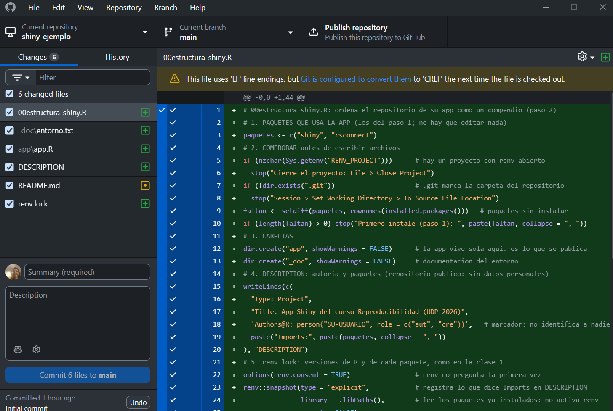{.captura}
2. Mensaje: `Agrega app Shiny`. Presione **Commit to main**.
3. Presione **Publish repository**.
4. **Desmarque** *Keep this code private* y presione **Publish repository**.
:::
::: {.column width="44%"}
::: {.ok}
**¿Cómo sé que funcionó?** Con **Repository → View on GitHub**, su repositorio muestra la carpeta `app` con `app.R` adentro.
:::

::: {.espejo}
Su app ya está guardada y respaldada, pero nadie más puede usarla: solo corre en su computador. Para eso son las partes 4 y 5.
:::
:::
::::

# Parte 4 · Publicar sin servidor {.seccion background-color="#8f4a4a"}

Con shinylive: primero un enlace, después GitHub Pages. Pasos 7 a 9.

## Shinylive: R viaja al navegador

:::: {.columns}
::: {.column width="55%"}
Una app Shiny necesita un computador con R que la mantenga corriendo. Una página web común solo entrega archivos: no corre R.

**Shinylive** empaqueta R, Shiny y su app. Quien visita la página los descarga y R corre **en su navegador**.

Es lo que usó en las etapas 1 a 5.
:::
::: {.column width="45%"}
::: {.ok}
**A favor:** gratis, sin servidor y sin cuentas nuevas.
:::

::: {.ojo}
**En contra:** la primera carga es lenta, y los datos viajan completos al computador de quien visita. Nunca con datos sensibles.
:::
:::
::::

## Paso 7 · Su app en un enlace

:::: {.columns}
::: {.column width="56%"}
1. Abra **[shinylive.io/r/editor](https://shinylive.io/r/editor/)**. Es el mismo editor de las etapas.
2. Borre el código de ejemplo y pegue el de su `app.R`.
3. Presione ▶ y revise que la app aparezca.
4. Presione **Share**. En *Application URL*, presione **Copy URL**.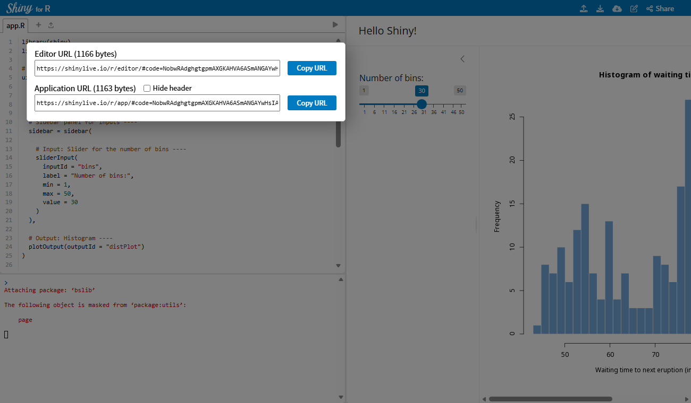{.captura}
5. Pegue la dirección en otra pestaña.
:::
::: {.column width="44%"}
::: {.ok}
**¿Cómo sé que funcionó?** La otra pestaña muestra su app, con su nombre en el título. Envíe esa dirección a alguien: le funciona sin instalar nada.
:::

::: {.espejo}
La dirección es larga porque **contiene** su app completa. Ya tiene algo para compartir: si un paso posterior falla, este enlace sigue funcionando.
:::
:::
::::

## Paso 8 · Dígale a GitHub Pages que publique con Actions

:::: {.columns}
::: {.column width="56%"}
El enlace del paso 7 es una copia suelta. Ahora la app se publicará desde su repositorio, en una dirección corta.

En el navegador, dentro de su repositorio `shiny-…`:

1. Entre a **Settings → Pages**.
2. En *Build and deployment*, en **Source**, cambie *Deploy from a branch* por **GitHub Actions**. 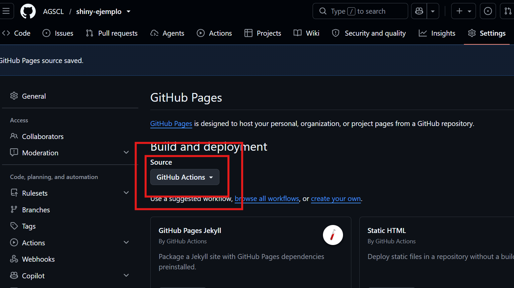{.captura}

No hay botón para guardar: queda guardado al elegir.
:::
::: {.column width="44%"}
::: {.ok}
**¿Cómo sé que funcionó?** En *Source* dice **GitHub Actions**.
:::

::: {.espejo}
**GitHub Actions** es un computador de GitHub que sigue una receta cada vez que hay un push. Con la misma idea se automatiza, por ejemplo, una extracción de datos de la web.
:::
:::
::::

## Paso 9 · Deje la receta y espere el visto verde {.etapa .receta}

:::: {.columns}
::: {.column width="44%"}
1. En la portada de su repositorio: **Add file → Create new file**. 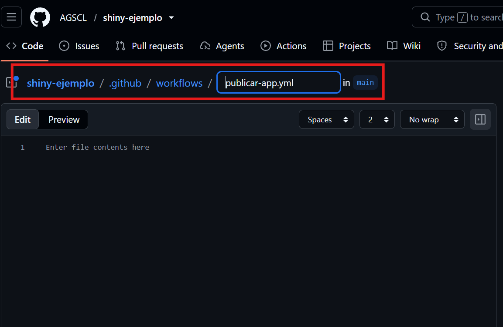{.captura}
2. En el nombre, escriba completo, con las barras:
   `.github/workflows/publicar-app.yml`
3. Pegue el contenido de la derecha. Cópielo con el botón.
4. Presione **Commit changes…** y confirme.
5. Entre a la pestaña **Actions** y espere el visto verde. Tarda varios minutos. 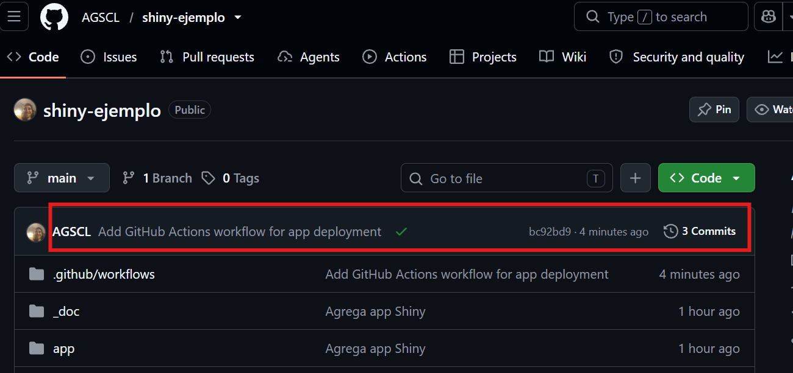{.captura}
6. Abra `https://USUARIO.github.io/shiny-NOMBRE/`
7. En GitHub Desktop: **Fetch origin** y **Pull origin**. Así baja a su computador el archivo que creó en la web.
:::
::: {.column width="56%"}
```yaml

```

::: {.ok}
**¿Cómo sé que funcionó?** Tras un círculo girando, esa dirección muestra su app.
:::

::: {.ojo}
**Ojo.** Los espacios al inicio de cada línea importan. **¿Equis roja en Actions?** Revise el paso 8, abra la ejecución y presione **Re-run all jobs**.
:::
:::
::::

# Parte 5 · Publicar con servidor {.seccion background-color="#8f4a4a"}

Posit Connect Cloud, desde GitHub. Pasos 10 a 13.

## Paso 10 · Prepare la lista de paquetes

:::: {.columns}
::: {.column width="56%"}
Connect Cloud necesita saber qué versión de R y qué paquetes usa su app. Esa lista es un archivo: `manifest.json`.

1. En RStudio, con `app.R` abierto: **Session → Set Working Directory → To Source File Location**. 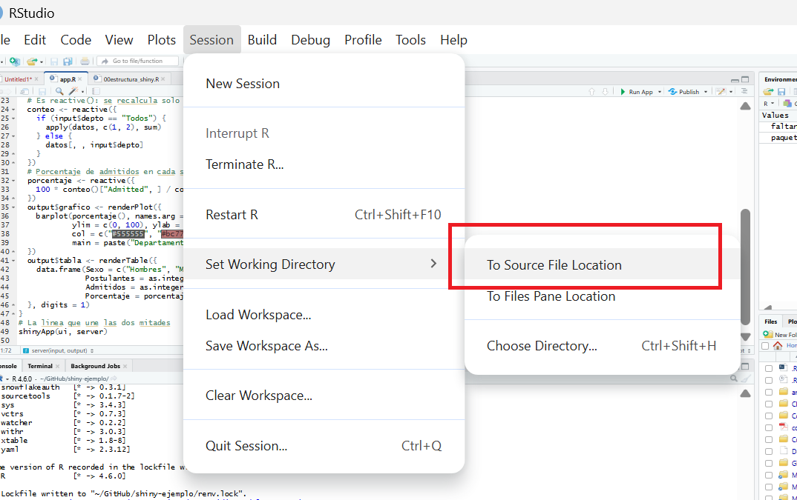{.captura}
2. En la consola:

```r
rsconnect::writeManifest()
```

3. En GitHub Desktop: mensaje `Agrega manifest para Connect Cloud`, **Commit to main** y **Push origin**.
:::
::: {.column width="44%"}
::: {.ok}
**¿Cómo sé que funcionó?** En la carpeta `app` hay un archivo nuevo, `manifest.json`, y ya está en github.com.
:::

::: {.espejo}
Es la misma idea del `renv.lock` de la primera clase: dejar por escrito el entorno para que otro computador pueda repetirlo.
:::
:::
::::

## Paso 11 · Cree su cuenta en Connect Cloud

:::: {.columns}
::: {.column width="56%"}
1. Entre a **[connect.posit.cloud](https://connect.posit.cloud)**. 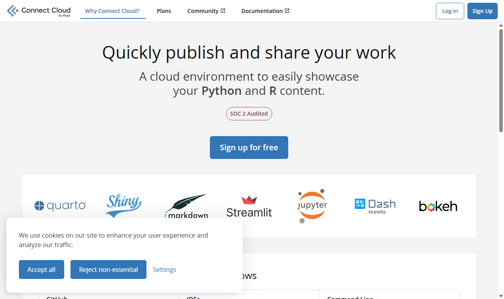{.captura}
2. Presione **Sign Up**.
3. Elija registrarse con **GitHub** y autorice.

Así no crea otra contraseña, y Connect Cloud queda enlazado a la cuenta donde está su repositorio.
:::
::: {.column width="44%"}
::: {.ok}
**¿Cómo sé que funcionó?** Entra a su página de inicio de Connect Cloud, todavía sin contenido.
:::

::: {.ojo}
**Ojo.** El plan gratuito solo publica desde repositorios **públicos**. El suyo ya lo es.
:::
:::
::::

## Paso 12 · Publique la app

:::: {.columns}
::: {.column width="56%"}
1. En **Home**, presione **Publish**. La primera vez le pide instalar la aplicación de Connect Cloud en GitHub: acepte.
2. Elija **Shiny**.
3. Elija su repositorio `shiny-…`.
4. **Branch**: `main`.
5. **Primary file**: `app/app.R`. 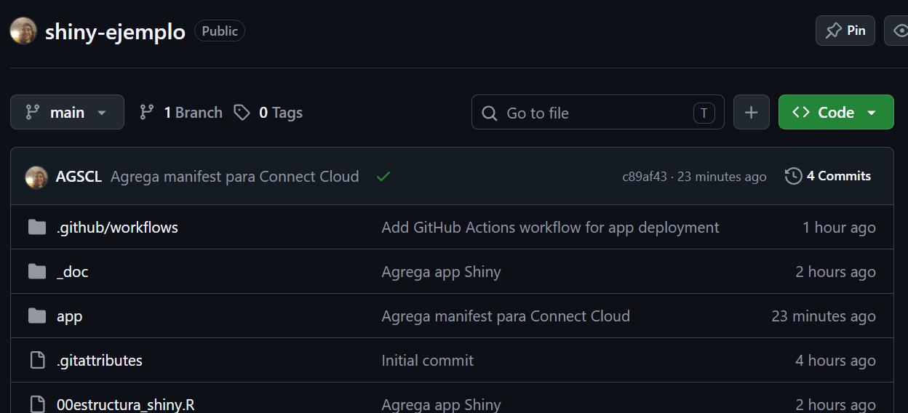{.captura}
6. Deje activado **Automatically publish on push**.
7. Presione **Publish**.
:::
::: {.column width="44%"}
::: {.ok}
**¿Cómo sé que funcionó?** Tras unos minutos de instalación, aparece su app en una dirección que termina en `share.connect.posit.cloud`. {.captura}
:::

::: {.ojo}
**¿Falla la publicación?** Lea el registro que muestra la página. Lo más común: falta `manifest.json` en la carpeta `app`, o no se hizo push.
:::
:::
::::

## Paso 13 · Cambie algo y mire sus tres direcciones

:::: {.columns}
::: {.column width="56%"}
1. En `app.R`, cambie el otro color del gráfico: `"#555555"` por `"orange"`.
2. Guarde, y en GitHub Desktop haga **commit** y **push**.
3. Espere unos minutos y recargue sus tres direcciones.
:::
::: {.column width="44%"}
::: {.ok}
**¿Qué debe ver?**

- **Connect Cloud** y **GitHub Pages** muestran el color nuevo: se publicaron solas con el push.
- **El enlace del paso 7** sigue igual: es una copia guardada dentro de la dirección.
:::
:::
::::

# Cierre {.seccion background-color="#8f4a4a"}

## Tres formas de publicar la misma app {.etapa}

|  | Enlace de shinylive | GitHub Pages + Actions | Posit Connect Cloud |
|---|---|---|---|
| ¿Dónde corre R? | En el navegador de quien visita | En el navegador de quien visita | En un servidor de Posit |
| ¿Qué necesita? | Nada | Un repositorio público | Un repositorio público y una cuenta |
| Primera carga | Lenta | Lenta | Rápida |
| Los datos | Viajan completos a quien visita | Viajan completos a quien visita | Se quedan en el servidor |
| Paquetes | Solo los preparados para navegador | Solo los preparados para navegador | Casi todos los de CRAN |
| Para actualizar | Crear un enlace nuevo | Solo push | Solo push |

::: {.ojo}
En los tres casos el código queda a la vista de cualquiera. Con datos que identifican personas, ninguna sirve tal como está.
:::

## Si algo falla {.etapa}

| Lo que ve | Qué hacer |
|---|---|
| El editor vivo queda en blanco | Use el enlace *Abrir este editor en una pestaña nueva*, o recargue la página. |
| R o RStudio no funcionan en su computador | Entre a [posit.cloud](https://posit.cloud), cree un proyecto de RStudio y siga ahí los pasos 1, 3, 4 y 10. |
| No tiene GitHub Desktop (por ejemplo, en Linux) | Cree `app/app.R` en github.com con **Add file → Create new file**, igual que en el paso 9. |
| **Run App** da un error | Vuelva a copiar el código completo. Casi siempre falta una coma o un paréntesis. |
| Equis roja en **Actions** | Revise que en el paso 8 diga *GitHub Actions* y que la carpeta se llame `app`. Después, **Re-run all jobs**. |
| La dirección de GitHub Pages da **404** | Espere a que Actions termine con visto verde y recargue. |
| Connect Cloud no publica | Revise que `manifest.json` esté en la carpeta `app` y que hizo push. |
| Nada de lo anterior resulta | Su enlace del paso 7 sigue funcionando. Avise y siga con la persona de al lado. |

## Lo que hizo hoy

:::: {.columns}
::: {.column width="50%"}
- Armó una app pieza por pieza: página, control, resultado, gráfico y orden.
- Hizo una app con datos reales y encontró algo que una tabla fija escondía.
- La publicó de tres formas.
- Vio que un push puede actualizar una app publicada.
:::
::: {.column width="50%"}
**Para seguir**

- **Desafío:** la misma idea con la ENSSEX. Código en [app-enssex.R](https://github.com/AGSCL/repr2026/blob/main/_lib/kit-shiny/app-enssex.R); necesita `enssex_base1.csv` en la carpeta `app`.
- [Mastering Shiny](https://mastering-shiny.org/), de Hadley Wickham. Libre en línea.
- La [clase de Shiny de 2025](https://github.com/JoseRTM/Reproducibilidad-UDP/tree/main/Clase4_Shiny), de José Ruiz-Tagle Maturana: más diseños de pantalla, filtros y tableros.
:::
::::

## Fuentes

::: {.chico}
- González-Santa Cruz, A. (2024). *Clase 5: Shiny*. Diplomado en Data Science para las Ciencias Sociales, UDP. <https://agscl.github.io/repr/clase5.html>
- Ruiz-Tagle Maturana, J. (2025). *Reproducibilidad-UDP, clase 4: Shiny* [repositorio de GitHub]. <https://github.com/JoseRTM/Reproducibilidad-UDP>
- Wickham, H. (2021). *Mastering Shiny*. O'Reilly. <https://mastering-shiny.org/>
- Posit. *Connect Cloud: Deploy a Shiny for R application*. <https://docs.posit.co/connect-cloud/how-to/r/shiny-r.html>
- Posit. *shinylive para R*, con su receta de GitHub Actions para publicar en GitHub Pages. <https://posit-dev.github.io/r-shinylive/>
- Bickel, P. J., Hammel, E. A. y O'Connell, J. W. (1975). Sex bias in graduate admissions: Data from Berkeley. *Science*, 187(4175), 398–404. Datos incluidos en R como `UCBAdmissions`.

Código de estas diapositivas: <https://github.com/AGSCL/repr2026>
:::

## Antes de irse: ¿cómo estuvo la clase?

:::: {.columns}
::: {.column width="45%"}
{height="600" fig-alt="Código QR que lleva a la encuesta de retroalimentación de la clase."}
:::
::: {.column width="55%"}
Apunte la cámara del teléfono al código y responda la encuesta de la clase.

Cuente qué le sirvió, qué quedó confuso y qué cambiaría. Con eso se ajusta la próxima sesión.

{height="300" fig-alt="Piolín da las gracias."}
:::
::::
