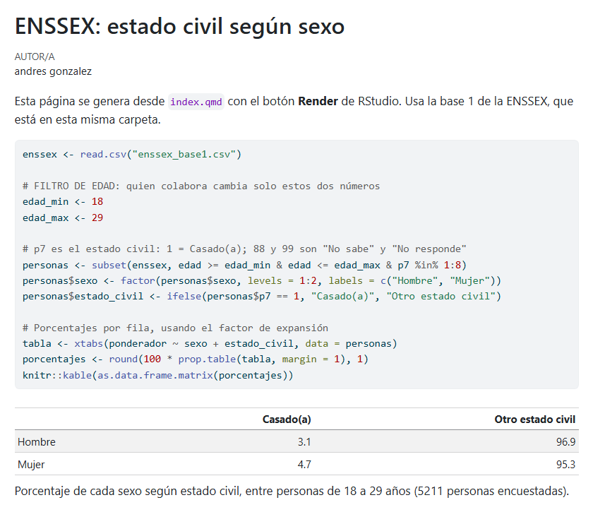
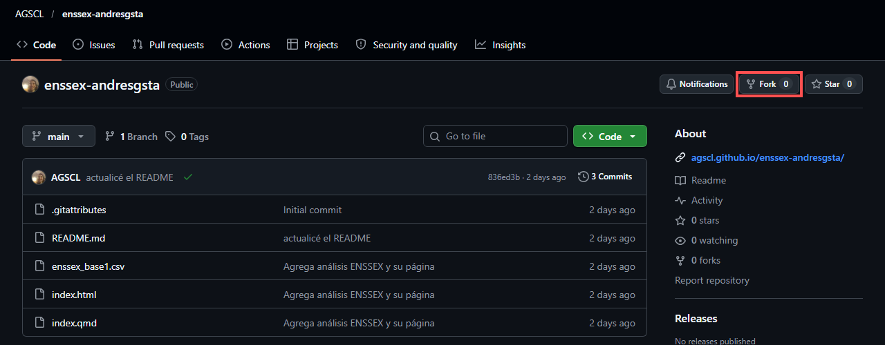
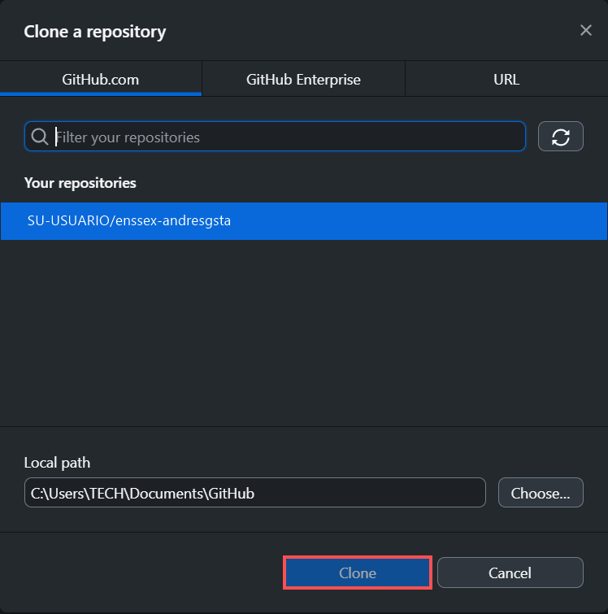
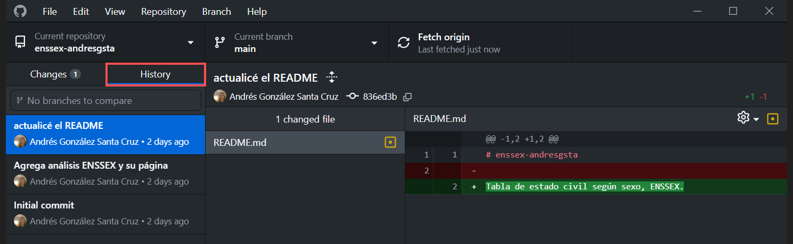
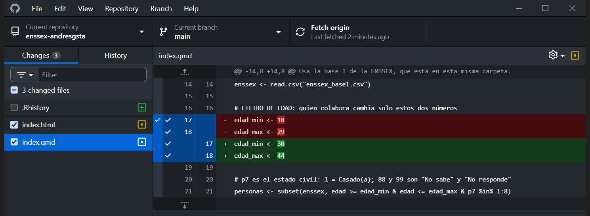
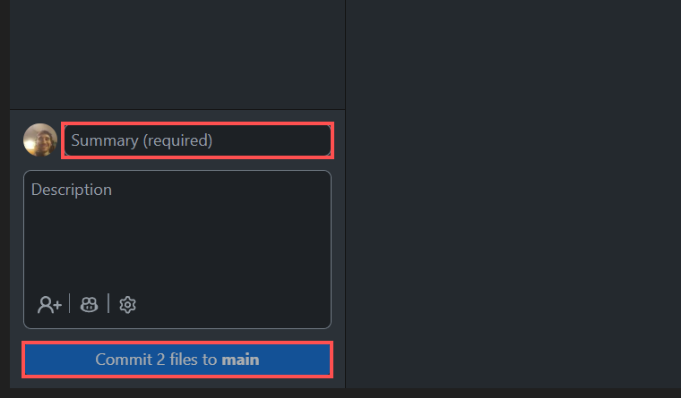
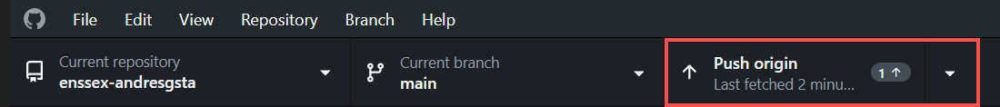
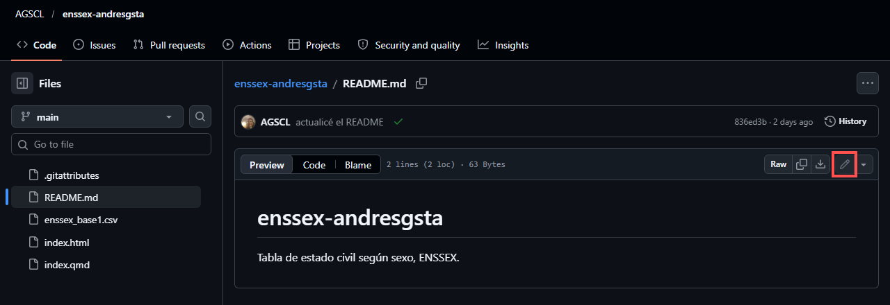
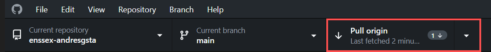
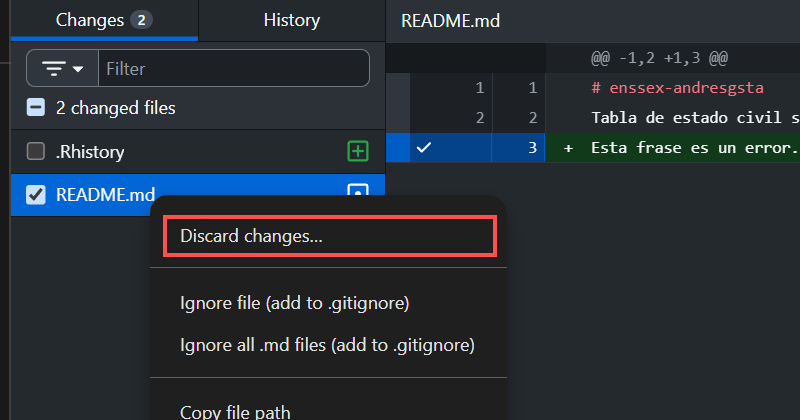

# Parte 1 · El encargo {.seccion background-color="#8f4a4a"}

Unos 45 minutos, a su ritmo. Ocho etapas.

## Un análisis que no es suyo

:::: {.columns}
::: {.column width="50%"}
El profesor publicó una tabla con la ENSSEX: **estado civil según sexo, entre personas de 18 a 29 años**.

El código está en GitHub: [github.com/AGSCL/enssex-andresgsta](https://github.com/AGSCL/enssex-andresgsta).

Usted quiere ver qué pasa en **otro tramo de edad** y proponerle ese cambio.

Hay un problema: ese repositorio no es suyo y no puede escribir en él.

::: {.ok}
**Lo que tendrá al terminar:** una copia propia del análisis, con su cambio guardado y subido, y una propuesta con su nombre en el repositorio del profesor.
:::
:::
::: {.column width="50%"}
{width="100%" fig-alt="La página publicada del análisis: título ENSSEX, estado civil según sexo, el código R con el filtro de edad de 18 a 29 años y una tabla de dos filas, Hombre y Mujer, con los porcentajes de Casado y Otro estado civil."}
:::
::::

## Cinco lugares

El mismo proyecto vive en cinco lugares. Cada etapa mueve algo entre dos de ellos.

::: {.sim data-etapa="mapa"}
:::

:::: {.columns}
::: {.column width="50%"}
**En su computador**

- **Sus archivos**: lo que ve en la carpeta y abre en RStudio.
- **Casilla**: la marca que elige qué archivos entran en el próximo commit.
- **Su historial**: las versiones guardadas (commits).
:::
::: {.column width="50%"}
**En github.com**

- **Su GitHub**: su copia del repositorio. Ahí puede escribir.
- **GitHub del profesor**: el original. Ahí solo puede proponer.

::: {.ojo}
Casi todas las confusiones con Git son no saber **en cuál de los cinco** quedó un cambio.
:::
:::
::::

## Cómo leer cada etapa

:::: {.columns}
::: {.column width="50%"}
Cada etapa tiene una idea y tres momentos:

1. **Ensaye.** Presione el botón del recuadro y mire qué lugar cambia. Es un dibujo: no toca nada suyo.
2. **Hágalo.** Los mismos pasos, de verdad, en GitHub y GitHub Desktop.
3. **Compruebe.** No siga hasta ver lo que dice la caja verde.

Al lado de algunas instrucciones hay una imagen muy chica. Con un clic se amplía.
:::
::: {.column width="50%"}
::: {.ok}
**¿Funcionó?** Lo que debe ver antes de seguir.
:::

::: {.espejo}
**Lo mismo, escrito.** El comando de Git que hace ese botón. No necesita escribirlo.
:::

::: {.ojo}
**Necesita** su cuenta de GitHub, GitHub Desktop con la sesión iniciada y RStudio. Son los de la [clase de Git](https://agscl.github.io/repr2026/clase-git/), pasos 1 a 4.
:::
:::
::::

# Parte 2 · Traer el proyecto {.seccion background-color="#8f4a4a"}

Del GitHub del profesor a su computador. Etapas 1 y 2.

## Etapa 1 · Fork: una copia en su GitHub {.etapa}

Un **fork** es una copia de un repositorio ajeno en **su** cuenta de GitHub. En esa copia manda usted.

::: {.sim data-etapa="fork"}
:::

:::: {.columns}
::: {.column width="54%"}
**Hágalo**

1. Entre a [github.com/AGSCL/enssex-andresgsta](https://github.com/AGSCL/enssex-andresgsta) con su sesión iniciada.
2. Arriba a la derecha, presione **Fork**. {.captura}
3. No cambie nada en la página que aparece. Presione **Create fork**.
:::
::: {.column width="46%"}
::: {.ok}
**¿Funcionó?** La dirección dice `github.com/SU-USUARIO/enssex-andresgsta` y bajo el nombre se lee *forked from AGSCL/enssex-andresgsta*.
:::

::: {.espejo}
**Lo mismo, escrito:** no existe. Fork es un botón de GitHub, no un comando de Git.
:::
:::
::::

## Etapa 2 · Clone: del fork a su computador {.etapa}

Su fork vive en github.com. **Clonar** baja a su computador los archivos y todo el historial.

::: {.sim data-etapa="clonar"}
:::

:::: {.columns}
::: {.column width="54%"}
**Hágalo**

1. En GitHub Desktop: **File → Clone repository…** {.captura}
2. Elija `SU-USUARIO/enssex-andresgsta` y presione **Clone**.
3. Si pregunta *How are you planning to use this fork?*, deje **To contribute to the parent project** y presione **Continue**.
4. Abra la pestaña **History**. {.captura}
:::
::: {.column width="46%"}
::: {.ok}
**¿Funcionó?** En History hay 3 commits del profesor. El de más arriba dice *actualicé el README*.
:::

::: {.ojo}
**Ojo.** Elija el repositorio que empieza con **su** usuario, no el de `AGSCL`.
:::

::: {.espejo}
**Lo mismo, escrito:** `git clone` y la dirección de su fork.
:::
:::
::::

# Parte 3 · Cambiar y guardar {.seccion background-color="#8f4a4a"}

Todo ocurre en su computador. Etapas 3 y 4.

## Etapa 3 · Cambiar: Git mira, usted decide {.etapa}

Git compara sus archivos con el último commit y muestra la diferencia. Todavía no guarda ninguna versión.

::: {.sim data-etapa="cambiar"}
:::

:::: {.columns}
::: {.column width="54%"}
**Hágalo**

1. En RStudio: **File → Open File…** y abra `index.qmd` desde `Documentos\GitHub\enssex-andresgsta`.
2. En `edad_min <- 18` y `edad_max <- 29` escriba otro tramo: 30 y 44, 45 y 59, o 60 y 100.
3. Guarde (Ctrl + S) y presione **Render**.
4. Vuelva a GitHub Desktop, pestaña **Changes**. {.captura}
:::
::: {.column width="46%"}
::: {.ok}
**¿Funcionó?** En Changes están `index.qmd` e `index.html`. Al hacer clic en `index.qmd`, la línea antigua sale en rojo y la nueva en verde.
:::

::: {.ojo}
**Si Render falla**, siga igual: basta el cambio en `index.qmd`.

**Si aparece `.Rhistory`**, quítele la marca de la casilla. Es de RStudio, no del análisis.
:::
:::
::::

## Etapa 4 · Commit: una versión con mensaje {.etapa}

Un **commit** guarda como versión lo que tiene la casilla marcada, con un mensaje que dice qué cambió.

::: {.sim data-etapa="commit"}
:::

:::: {.columns}
::: {.column width="54%"}
**Hágalo**

1. En **Changes**, deje marcados `index.qmd` e `index.html`.
2. Abajo a la izquierda, en **Summary**, escriba el mensaje con su tramo: `Cambia tramo de edad a 30-44 años` {.captura}
3. Presione **Commit to main**.
:::
::: {.column width="46%"}
::: {.ok}
**¿Funcionó?** En History hay 4 commits. El de más arriba es el suyo, con su nombre.
:::

::: {.espejo}
**Lo mismo, escrito:**

```bash
git add index.qmd index.html
git commit -m "Cambia tramo de edad a 30-44 años"
```
:::
:::
::::

## Antes de seguir: ¿dónde está su cambio? {.etapa}

Responda sin mirar GitHub.

1. Guardó `index.qmd` con Ctrl + S. ¿Eso creó un commit?
2. Hizo el commit. ¿Ya se ve su tramo en `github.com/SU-USUARIO/enssex-andresgsta`?
3. ¿Cambió algo en el repositorio del profesor?

. . .

::: {.ok}
**Tres veces no.**

1. Guardar cambia el archivo. El commit es un paso aparte: lo hizo en la etapa 4.
2. El commit está en su historial, en su computador. A su GitHub llega con un push: es la etapa 5.
3. Al profesor solo le llega una propuesta, y cuando usted la envíe: es la etapa 8.
:::

| Lo que hizo | Sus archivos | Su historial | Su GitHub | GitHub del profesor |
|---|---|---|---|---|
| Guardar (Ctrl + S) | Cambia | | | |
| Commit | | Cambia | | |
| Push | | | Cambia | |
| Pull request | | | | Recibe una propuesta |

# Parte 4 · Sincronizar {.seccion background-color="#8f4a4a"}

Entre su computador y su GitHub, en las dos direcciones. Etapas 5 y 6.

## Etapa 5 · Push: de su computador a su GitHub {.etapa}

Su commit solo existe en su computador. **Push** sube a su fork los commits que le faltan.

::: {.sim data-etapa="push"}
:::

:::: {.columns}
::: {.column width="54%"}
**Hágalo**

1. En GitHub Desktop, arriba a la derecha, presione **Push origin**. {.captura}
2. Abra su fork en el navegador: **Repository → View on GitHub**.
:::
::: {.column width="46%"}
::: {.ok}
**¿Funcionó?** Sobre la lista de archivos está su mensaje de commit. Más arriba dice *This branch is 1 commit ahead of AGSCL/enssex-andresgsta:main*.
:::

::: {.ojo}
**Si Push da un error de permiso**, clonó el repositorio del profesor y no su fork. Vea *Si algo falla*, al final.
:::

::: {.espejo}
**Lo mismo, escrito:** `git push`
:::
:::
::::

## Etapa 6 · Pull: de su GitHub a su computador {.etapa}

Un repositorio también cambia en GitHub: desde otro computador o por otra persona. **Pull** trae esos commits.

::: {.sim data-etapa="pull"}
:::

:::: {.columns}
::: {.column width="54%"}
**Hágalo**

1. En su fork, en github.com, haga clic en `README.md` y después en el lápiz. {.captura}
2. Agregue una línea: `Tramo cambiado por` y su nombre.
3. Presione **Commit changes…** y confirme con **Commit changes**.
4. En GitHub Desktop presione **Fetch origin**. El botón cambia a **Pull origin**: presiónelo. {.captura}
:::
::: {.column width="46%"}
::: {.ok}
**¿Funcionó?** History tiene 5 commits. El `README.md` de su carpeta trae la línea nueva: véalo con **Repository → Show in Explorer**.
:::

::: {.espejo}
**Lo mismo, escrito:** `git pull`
:::
:::
::::

# Parte 5 · Deshacer y proponer {.seccion background-color="#8f4a4a"}

Volver atrás sin miedo y cerrar la vuelta. Etapas 7 y 8.

## Etapa 7 · Descartar: volver al último commit {.etapa}

Mientras un cambio no tenga commit, se puede descartar: el archivo vuelve a la última versión guardada.

::: {.sim data-etapa="descartar"}
:::

:::: {.columns}
::: {.column width="54%"}
**Hágalo**

1. Abra el `README.md` de su carpeta en RStudio, escriba `Esta frase es un error.` y guarde.
2. En GitHub Desktop, en **Changes**, haga clic derecho sobre `README.md` → **Discard changes…** {.captura}
3. Confirme con **Discard changes**.
:::
::: {.column width="46%"}
::: {.ok}
**¿Funcionó?** Changes queda vacío, la frase ya no está en el archivo y History sigue con 5 commits.
:::

::: {.ojo}
**Ojo.** Descartar solo alcanza a lo que no tiene commit. Para anular un commit ya hecho: en History, clic derecho → **Revert changes in commit**.
:::

::: {.espejo}
**Lo mismo, escrito:** `git restore README.md`
:::
:::
::::

## Etapa 8 · Pull request: proponer su cambio {.etapa}

Su fork tiene 2 commits que el profesor no tiene. Un **pull request** le propone traerlos. Él decide si los acepta.

::: {.sim data-etapa="pr"}
:::

:::: {.columns}
::: {.column width="54%"}
**Hágalo**

1. En su fork, en github.com, presione **Contribute → Open pull request**. {.captura}
2. Lea la línea de arriba: *base repository: AGSCL/…* a la izquierda y *head repository: SU-USUARIO/…* a la derecha.
3. En el título escriba su tramo y su nombre: `Tramo 30-44 años, María Pérez`.
4. Presione **Create pull request**.
:::
::: {.column width="46%"}
::: {.ok}
**¿Funcionó?** Su propuesta aparece, con su título, en [github.com/AGSCL/enssex-andresgsta/pulls](https://github.com/AGSCL/enssex-andresgsta/pulls).
:::

::: {.espejo}
**Lo mismo, escrito:** tampoco existe. El pull request es de GitHub, no de Git.
:::
:::
::::

# Cierre {.seccion background-color="#8f4a4a"}

## Lo que hizo, con sus nombres {.etapa}

| Etapa | Botón | Qué movió | Comando |
|---|---|---|---|
| 1 | **Fork** | Del GitHub del profesor a su GitHub | No tiene: es de GitHub |
| 2 | **Clone** | De su GitHub a su computador | `git clone` |
| 3 | Guardar (Ctrl + S) | Del editor a sus archivos | No tiene: Git solo mira |
| 4 | **Commit to main** | De los archivos marcados a su historial | `git add` y `git commit` |
| 5 | **Push origin** | De su historial a su GitHub | `git push` |
| 6 | **Pull origin** | De su GitHub a su computador | `git pull` |
| 7 | **Discard changes** | Del último commit a sus archivos | `git restore` |
| 8 | **Create pull request** | De su GitHub a una propuesta para el profesor | No tiene: es de GitHub |

::: {.ok}
Con ramas y con más personas la vuelta es la misma. Eso está en la parte 3 de la [clase de Git](https://agscl.github.io/repr2026/clase-git/).
:::

## Si algo falla {.etapa}

| Lo que ve | Qué hacer |
|---|---|
| GitHub pide iniciar sesión al presionar **Fork** | Inicie sesión y vuelva a la dirección del repositorio. |
| En **Clone repository** no aparece su fork | En esa misma ventana, pestaña **URL**: pegue la dirección de su fork, la que tiene su usuario. |
| **Render** da un error | Siga sin renderizar. El commit puede llevar solo `index.qmd`. |
| En Changes aparece `.Rhistory` | Quítele la marca de la casilla antes del commit. |
| **Push origin** da un error de permiso (403) | Clonó el repositorio del profesor. En **Repository → Repository settings… → Remote**, la dirección debe tener su usuario. Si dice `AGSCL`, repita las etapas 1 y 2. |
| No aparece **Pull origin** | Presione primero **Fetch origin**. |
| Descartó algo que quería conservar | GitHub Desktop lo deja en la Papelera de reciclaje. |
| No aparece **Contribute** | Está en el repositorio del profesor. Vaya a su fork: la dirección tiene su usuario. |
| Nada de lo anterior resulta | Lo que subió con push sigue en su GitHub. Escriba al profesor con una captura de lo que ve. |

## Fuentes

::: {.chico}
- GitHub Docs. *Fork a repository*. <https://docs.github.com/en/pull-requests/collaborating-with-pull-requests/working-with-forks/fork-a-repo>
- GitHub Docs. *Creating a pull request from a fork*. <https://docs.github.com/en/pull-requests/collaborating-with-pull-requests/proposing-changes-to-your-work-with-pull-requests/creating-a-pull-request-from-a-fork>
- GitHub Docs. *Cloning and forking repositories from GitHub Desktop*. <https://docs.github.com/en/desktop/adding-and-cloning-repositories/cloning-and-forking-repositories-from-github-desktop>
- Git. *git-restore*. <https://git-scm.com/docs/git-restore>
- Diapositivas de la clase de Git de este curso. <https://agscl.github.io/repr2026/clase-git/>

Código de estas diapositivas: <https://github.com/AGSCL/repr2026>
:::

## Antes de irse: ¿cómo estuvo el taller?

:::: {.columns}
::: {.column width="45%"}
{height="600" fig-alt="Código QR que lleva a la encuesta de retroalimentación de la clase."}
:::
::: {.column width="55%"}
Apunte la cámara del teléfono al código y responda la encuesta.

Cuente en qué etapa se trabó y qué quedó confuso. Con eso se ajusta el material.

{height="300" fig-alt="Piolín da las gracias."}
:::
::::
