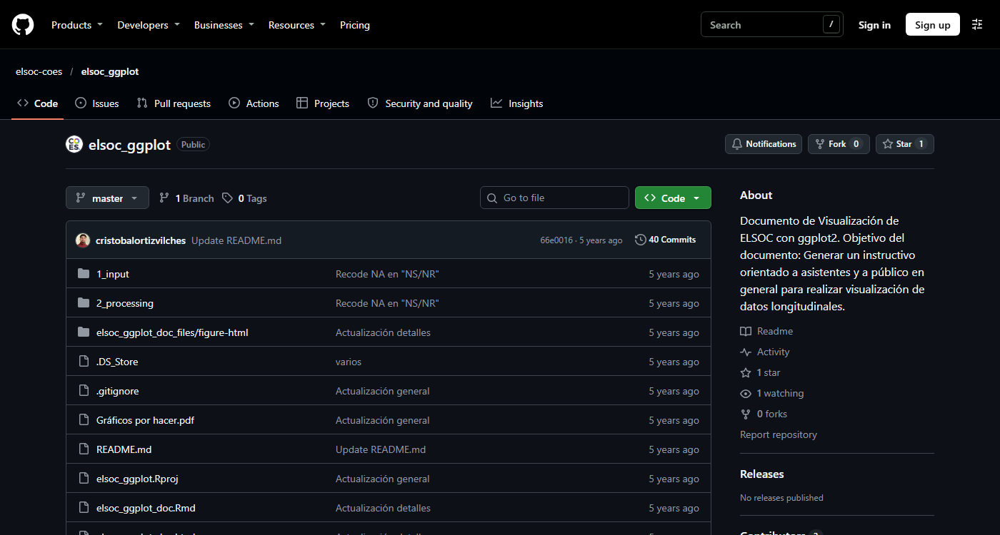
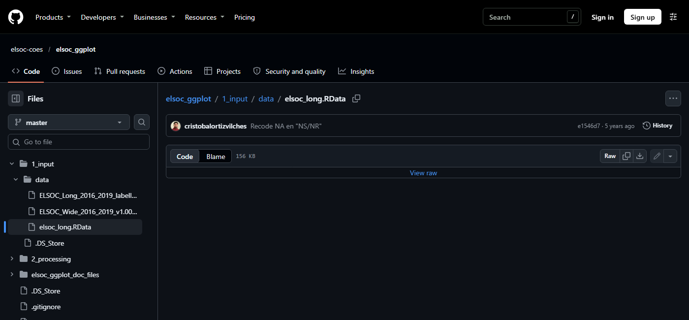
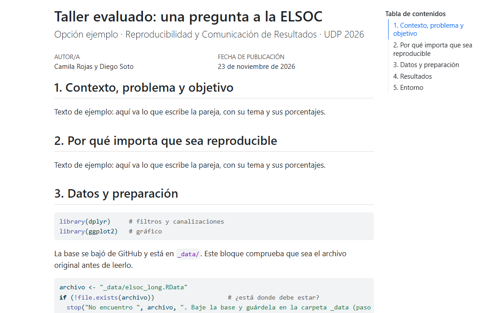
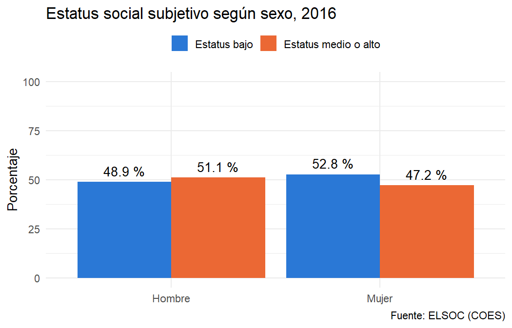
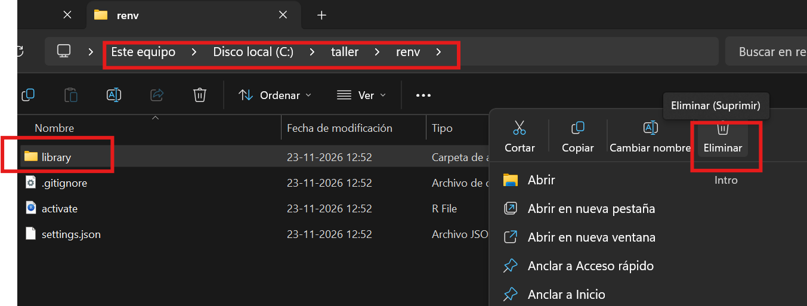
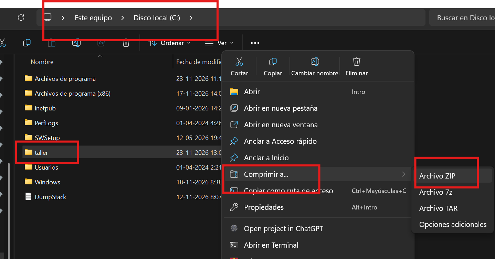

# Parte 1 · Qué se pide {.seccion background-color="#8f4a4a"}

En parejas. Seis pasos. La entrega es un ZIP en Canvas.

::: {.notes}
- 10 min. Todavía no se abre RStudio.
- Meta: cada pareja sabe qué entrega, cuál es su opción y con qué criterios se evalúa.
- Teclas: **S** abre estas notas; **doble clic** amplía; **O** muestra todas las láminas.
:::

## Qué va a entregar

:::: {.columns}
::: {.column width="56%"}
Un ZIP con la carpeta de su proyecto, en Canvas. Adentro va un compendio:

- **El informe**: `informe.qmd` y su `informe.html`, con los nombres de la pareja, la fecha, una tabla de 2 × 2, un gráfico, tres textos cortos y la información de la sesión.
- **Los datos**: la base ELSOC que bajó de GitHub.
- **El entorno**: el guion que armó el compendio, `renv.lock`, `DESCRIPTION` y `README.md`.

Recibe un kit con el proyecto y la plantilla del informe. El guion lo copia de estas láminas y lo completa.
:::
::: {.column width="44%"}
::: {.ok}
**Lo que se evalúa:** que sepa armar un compendio, completar un documento dinámico, renderizarlo y entregarlo de modo que otra persona lo pueda repetir.
:::

::: {.ojo}
**En parejas.** Cada pareja recibe una opción, del 1 al 5. Se entrega hasta el **domingo 29 de noviembre a las 23:59**.
:::

::: {.espejo}
Vale el 40 % de la nota del curso, según el programa.
:::
:::
::::

::: {.notes}
- Un solo archivo en Canvas: el ZIP que la pareja arma en el paso 6.
- No es una prueba de tablas ni de gráficos: el código viene casi completo.
- Decir en voz alta qué opción tiene cada pareja y anotarla.
- El programa habla de 5 a 10 páginas; aquí el informe es una página web con cinco secciones.
:::

## Las cinco opciones {.etapa .tabla}

Todas hacen la misma pregunta: **¿difieren hombres y mujeres?** Cambian el año y el tema.

| Opción | Ola | Tema | Variable | Categorías que forman el primer grupo |
|---|---|---|---|---|
| **1** | 2016 | Confianza en Carabineros | `conf_carb` | `"Bastante"` y `"Mucho"` |
| **2** | 2017 | Confianza en el Presidente o la Presidenta | `conf_presi` | `"Nada"` |
| **3** | 2018 | Confianza en los partidos políticos | `conf_part` | `"Nada"` |
| **4** | 2019 | Cambiar la Constitución | `cambiar_consti` | `"De acuerdo o totalmente de acuerdo"` |
| **5** | 2018 | Identificación con un partido político | `idpart` | `"Ninguno"` |

: {tbl-colwidths="[8,8,34,18,32]"}

El segundo grupo es el resto de las respuestas. Los nombres de los dos grupos y el título del gráfico los decide la pareja.

::: {.ojo}
Use solo la opción que le asignaron. Estos datos se escriben en el código de `informe.qmd`, en el paso 5.
:::

::: {.notes}
- ELSOC: Estudio Longitudinal Social de Chile, del COES. Las mismas 1.886 personas, entrevistadas en 2016, 2017, 2018 y 2019.
- Formato largo: una fila por persona y ola. Por eso el primer paso del código es filtrar una ola.
- La tabla es de 2 × 2: sexo (hombre, mujer) por dos grupos de respuesta.
- Las categorías van tal cual, con mayúsculas: una letra distinta y la tabla no sale de 2 × 2.
- Opción 4: en la base, la categoría contraria viene con una errata («En desacuendo…»). No hay que escribirla.
:::

## Ruta: seis pasos

:::: {.columns}
::: {.column width="50%"}
**Armar el compendio**

1. Baje el kit y abra el proyecto.
2. Copie el guion, complételo y ejecútelo.
3. Baje la base desde GitHub.
:::
::: {.column width="50%"}
**El informe y la entrega**

4. Identifique el informe: opción y nombres.
5. Complete el código y renderice.
6. Escriba los textos, comprima y entregue.
:::
::::

Necesita R, RStudio e internet. Tiempo estimado: entre una hora y una hora y media.

[Un doble clic amplía cualquier parte de la lámina. Otro doble clic la devuelve.]{.chico}

::: {.notes}
- Pasos 1 a 3: unos 20 min, casi todo espera de instalación.
- Pasos 4 a 6: unos 45 min. Lo que más tarda son los tres textos.
- Si una pareja se atrasa en el paso 2 por la red, que avance leyendo su opción.
:::

# Parte 2 · Armar el compendio {.seccion background-color="#8f4a4a"}

Pasos 1 a 3. Al final tendrá las carpetas, los paquetes y los datos.

::: {.notes}
- Unos 20 min. El paso 2 instala 47 paquetes: en mi equipo tardó un minuto.
:::

## Paso 1 · Baje el kit y abra el proyecto {.etapa}

:::: {.columns}
::: {.column width="56%"}
El kit trae dos archivos: el proyecto y la plantilla del informe.

1. Baje [kit-taller.zip](https://agscl.github.io/repr2026/taller/kit-taller.zip).
2. En la carpeta de descargas: clic derecho sobre el ZIP y **Extraer todo…** Elija una carpeta corta, por ejemplo `C:\taller`.
3. Entre a esa carpeta y haga doble clic en `TallerELSOC.Rproj`.
:::
::: {.column width="44%"}
::: {.ok}
**¿Cómo sé que funcionó?** RStudio muestra `TallerELSOC` arriba a la derecha. La pestaña **Files** lista `informe.qmd` y `TallerELSOC.Rproj`.
:::

::: {.ojo}
**Ojo.** Un doble clic sobre el ZIP solo lo muestra por dentro: hay que extraerlo. Si trabaja dentro del ZIP, nada se guarda.
:::

::: {.aviso}
Sin tildes, ñ ni espacios en la ruta. Evite las carpetas de OneDrive y Google Drive.
:::
:::
::::

::: {.notes}
- El kit también puede estar en Canvas: es el mismo archivo.
- Error típico: abrir `informe.qmd` desde el ZIP. Se nota porque Files no muestra los dos archivos.
- OneDrive bloquea archivos mientras sincroniza y la instalación de paquetes falla a medias.
- Abrir siempre por el `.Rproj`: así la carpeta de trabajo es la del proyecto.
:::

## Paso 2 · Prepare el compendio {.etapa .guion}

:::: {.columns}
::: {.column width="25%"}
1. En RStudio: **File → New File → R Script**.
2. Copie el guion con el botón de su esquina superior derecha y péguelo.
3. Complete las dos líneas que siguen a cada `INSTRUCCION`.
4. Guárdelo como `00estructura_taller.R`, junto a `TallerELSOC.Rproj`.
5. Presione **Source**. Necesita internet y tarda unos minutos.
:::
::: {.column width="75%"}
```r

```
:::
::::

::: {.notes}
- Esta lámina es parte de la prueba: no se explica qué va en cada espacio.
- INSTRUCCION 1: los dos paquetes que usa el informe. INSTRUCCION 2: las cuatro carpetas que nombra el README de la sección 7.
- Si quedan espacios sin completar, el guion se detiene antes de crear nada.
- Con una carpeta mal escrita, el guion falla al escribir `_doc/entorno.txt` o el informe no encuentra dónde guardar.
- Se puede repetir: corregir y presionar Source otra vez.
- DESCRIPTION no lleva nombres: los nombres van solo en el informe.
:::

## Paso 3 · Baje la base desde GitHub {.etapa}

:::: {.columns}
::: {.column width="56%"}
La base está en un repositorio público del COES. Hay que traerla a la carpeta de datos de su proyecto.

1. Abra [github.com/elsoc-coes/elsoc_ggplot](https://github.com/elsoc-coes/elsoc_ggplot) y entre a `1_input`, después a `data` y después a `elsoc_long.RData`. {.captura}
2. Presione la flecha hacia abajo, **Download raw file**, arriba a la derecha. {.captura}
3. Mueva el archivo desde la carpeta de descargas a la carpeta `_data` del proyecto.

**O con una línea**, en la consola de RStudio:

```r
download.file("https://raw.githubusercontent.com/elsoc-coes/elsoc_ggplot/master/1_input/data/elsoc_long.RData", "_data/elsoc_long.RData", mode = "wb")
```
:::
::: {.column width="44%"}
::: {.ok}
**¿Cómo sé que funcionó?** En **Files**, dentro de `_data`, está `elsoc_long.RData` y pesa 155,8 KB.
:::

::: {.ojo}
**Ojo con el nombre.** Debe ser exactamente `elsoc_long.RData`. No sirve `elsoc_long (1).RData`. No lo abra con doble clic.
:::

::: {.minimo}
**Si la red bloquea la descarga:** en la página del repositorio, **Code → Download ZIP**. Extraiga y copie `1_input/data/elsoc_long.RData` a `_data`. O use otra red.
:::
:::
::::

::: {.notes}
- Hay tres bases en esa carpeta. La del taller es la chica: `elsoc_long.RData`, 156 KB.
- `mode = "wb"` importa en Windows: sin eso el archivo llega dañado.
- El informe comprueba la huella (md5) del archivo antes de leerlo: si guardaron la página web en vez del archivo, se detiene y lo dice.
- Algunas redes de trabajo bloquean `raw.githubusercontent.com`. El ZIP del repositorio completo (12 MB) sale por otra dirección y trae el mismo archivo.
- También sirve clonar con GitHub Desktop: File → Clone repository → URL → `elsoc-coes/elsoc_ggplot`.
:::

# Parte 3 · El informe y la entrega {.seccion background-color="#8f4a4a"}

Pasos 4 a 6. Casi todo ocurre en `informe.qmd`.

::: {.notes}
- Unos 45 min.
- La plantilla trae el código con espacios en blanco. Se completan la opción, los nombres, seis espacios y tres textos.
:::

## Paso 4 · Identifique el informe {.etapa}

:::: {.columns}
::: {.column width="56%"}
El encabezado dice qué opción es, quién lo hizo y cuándo.

1. En **Files**, abra `informe.qmd`.
2. En la línea 3, cambie `______` por el número de su opción.
3. En la línea 4, cambie `Nombre Apellido y Nombre Apellido` por los dos nombres. Deje las comillas.
4. Guarde con Ctrl + S.

```yaml
subtitle: "Opción 3 · Reproducibilidad y Comunicación de Resultados · UDP 2026"
author: "Camila Rojas y Diego Soto"
date: today
```
:::
::: {.column width="44%"}
::: {.espejo}
**La fecha se escribe sola.** `date: today` pone el día en que se renderiza. Así el informe dice cuándo se produjo de verdad.
:::

::: {.ojo}
**Ojo.** No borre los tres guiones `---` que abren y cierran el encabezado.
:::
:::
::::

::: {.notes}
- Los nombres del ejemplo son inventados.
- El encabezado se llama YAML. Las sangrías y las comillas importan.
- Si RStudio abre el archivo en modo **Visual**, pasar a **Source** con el botón de arriba a la izquierda: es más fácil ver las líneas.
:::

## Paso 5 · Complete el código y renderice {.etapa}

:::: {.columns}
::: {.column width="54%"}
1. En `informe.qmd`, busque las dos líneas que dicen `INSTRUCCION`.
2. Complete cada `______` con los datos de su opción: la ola, la variable y las categorías del primer grupo.
3. Escriba un nombre para cada grupo y un título para el gráfico.
4. Guarde y presione **Render**.
5. Revise el informe: su opción, sus nombres, dos tablas de 2 × 2 y un gráfico. {.captura}
:::
::: {.column width="46%"}
{width="100%" fig-alt="Ejemplo de gráfico: cuatro barras, dos para hombres y dos para mujeres, en azul y naranjo según el grupo de respuesta, con el porcentaje sobre cada barra, un título y la fuente."}

[Ejemplo con una variable que no está entre las opciones.]{.chico}
:::
::::

::: {.notes}
- Los datos de cada opción están en la lámina «Las cinco opciones».
- Si falta la base, el mensaje dice `No encuentro _data/…`. Si una categoría está mal escrita, dice que la tabla no es de 2 × 2.
- Render guarda también la tabla en `_outputs/tabla.csv` y el gráfico en `_figures/grafico.png`.
- El ejemplo usa `estatus` (estatus social subjetivo), ola 2016: 48,9 % de los hombres y 52,8 % de las mujeres en estatus bajo; 1.879 personas.
- Render usa la biblioteca del proyecto. Por eso hay que abrir por el `.Rproj`.
:::

## Paso 6 · Escriba, comprima y entregue {.etapa}

:::: {.columns}
::: {.column width="56%"}
1. Reemplace cada `ESCRIBA AQUÍ` por un texto suyo de tres a cinco líneas y presione **Render**.
2. Cierre RStudio.
3. En la carpeta del proyecto, entre a `renv` y elimine la carpeta `library`. Solo esa. {.captura}
4. Vuelva atrás. Clic derecho sobre la carpeta del proyecto y **Comprimir a… → Archivo ZIP**. En Windows 10: **Enviar a → Carpeta comprimida**. {.captura}
5. Suba el ZIP a la tarea de Canvas, hasta el domingo 29 de noviembre a las 23:59. Una entrega por pareja.
:::
::: {.column width="44%"}
**La entrega está completa si**

- los tres textos nombran su tema y sus porcentajes;
- el ZIP pesa menos de 2 MB;
- trae el informe en `.qmd` y en `.html`, la base, la tabla, el gráfico, el guion y los archivos del entorno;
- otra persona lo repite con `renv::restore()` y **Render**.

[`library` guarda los paquetes instalados: 78 MB que se reinstalan con `renv::restore()`. Lo que los describe es `renv.lock`, y ese sí se entrega.]{.chico}
:::
::::

::: {.notes}
- Los tres textos: contexto y objetivo (sección 1), reproducibilidad, replicabilidad y ciencia abierta (sección 2), interpretación con una limitación (sección 4).
- Reproducible: mismos datos y mismo código, mismos resultados. Replicable: datos nuevos y mismo método, resultados en la misma dirección.
- Hay que cerrar RStudio antes de borrar: mientras está abierto, Windows no deja eliminar los paquetes en uso.
- Dentro de `renv` se quedan `activate.R` y `settings.json`. Si los borran, el proyecto no se puede restaurar.
- Con `library`, el ZIP pesa cerca de 47 MB y trae unos 3.600 archivos.
- Así corrijo: `revisar_taller("entrega.zip")`, después `renv::restore()`, Render y comparar con la pauta.
:::

## Criterios de evaluación: 20 puntos {.etapa .tabla}

| Criterio | Puntos | Completo | A medias: la mitad de los puntos |
|---|---|---|---|
| **1. Entrega y compendio** | 2 | El ZIP está en Canvas, sin la carpeta `library`, y trae la base, la tabla, el gráfico, `informe.qmd` e `informe.html`, cada uno en su lugar | Falta una pieza, viene `library` o los archivos llegaron sueltos |
| **2. Entorno y dependencias** | 4 | El guion tiene sus dos instrucciones completas; están `renv.lock`, `DESCRIPTION`, `README.md` y `_doc/entorno.txt`, y el informe termina con la información de la sesión | Falta uno, o una instrucción quedó mal |
| **3. Se repite en otro equipo** | 3 | Con `renv::restore()` y **Render**, el profesor obtiene los mismos números | Corre solo después de corregir una línea |
| **4. Datos de su opción** | 3 | La ola, la variable y las categorías son las de la opción asignada y la tabla de 2 × 2 coincide con la pauta | Un dato no corresponde, o es otra opción |
| **5. Gráfico** | 2 | Título y nombres de grupo propios, que dicen de qué trata | El título o los grupos no dicen de qué trata |
| **6. Documento dinámico** | 2 | Número de opción, nombres de la pareja y fecha; el HTML sale del `.qmd` sin retoques a mano | Falta un dato, o el HTML no coincide con el `.qmd` |
| **7. Tres textos** | 4 | Los tres nombran su tema y sus porcentajes: objetivo, reproducibilidad e interpretación con una limitación | Falta uno, o son genéricos |

: {tbl-colwidths="[21,7,42,30]"}

::: {.espejo}
Sin evidencia de un criterio, 0 puntos en ese criterio. **Nota 4,0 con 12 puntos; nota 7,0 con 20.**
:::

::: {.notes}
- Nota: hasta 12 puntos, 1 + 0,25 por punto. Sobre 12, 4 + 0,375 por punto sobre 12.
- El criterio 3 se revisa extrayendo el ZIP en una carpeta nueva.
- El criterio 7 es el que más exige redactar: un texto que serviría para cualquier opción queda a medias.
- Dejar esta lámina proyectada mientras trabajan.
:::
